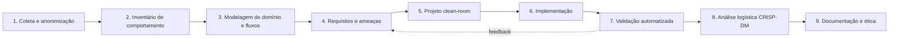

# 01 — Metodologia

## 1. Caracterização da pesquisa

A pesquisa é **aplicada, qualitativa e exploratória**, com desenvolvimento
tecnológico (design science). O fenômeno estudado é um sistema de informação em
operação, acessível apenas por sua interface. O resultado é um artefato — o
protótipo — avaliado por testes automatizados, teste de fumaça e aderência aos
requisitos derivados das evidências.

A estratégia combina três abordagens complementares:

| Abordagem | Papel | Produto |
| --- | --- | --- |
| **Engenharia reversa de caixa-preta** | Descobrir o comportamento externo sem acessar implementação | Dossiê, inventário funcional, achados |
| **Design science research** | Projetar e avaliar um artefato que resolva o problema | Protótipo, OpenAPI, schema, PWA |
| **CRISP-DM** | Organizar a análise dos dados operacionais | Indicadores, análise em `analytics/` |

## 2. Por que caixa-preta

A engenharia reversa pode ser feita em três níveis:

1. **Caixa-branca:** código-fonte, binários, banco e contratos disponíveis.
2. **Caixa-cinza:** documentação parcial, APIs públicas e logs.
3. **Caixa-preta:** apenas entradas, saídas e comportamento observável.

Neste trabalho só o nível **caixa-preta** era ético e legalmente viável. Isso
impõe limites explícitos: não é possível afirmar como o sistema original
armazena dados, quais algoritmos usa ou como autentica sessões. O dossiê separa
**observação**, **inferência** e **hipótese**, com níveis de confiança.

> Princípio: *não inferir implementação a partir de aparência*. Uma tela que
> mostra “CPF” não autoriza concluir que o CPF é armazenado em claro. O achado
> deve descrever o risco observável e a decisão de projeto, não uma acusação
> técnica não comprovada.

## 3. Fases do método

### Fase 1 — Coleta e anonimização

- Recebimento de capturas de tela do sistema em uso, no contexto do TCC.
- Remoção de dados pessoais por tarjas opacas (CPF, nome, placa, telefone,
  e-mail, operadora), antes de qualquer versionamento.
- Geração de cópias PNG, cálculo de SHA-256 e manifesto com descrição,
  origem e quantidade de redações.
- Descarte dos originais fora do repositório.

Ferramenta: [`scripts/redact_evidencias.py`](../scripts/redact_evidencias.py).
Produto: [`reverse-engineering/evidencias/`](../reverse-engineering/evidencias/).

### Fase 2 — Inventário de comportamento

Para cada captura, registra-se:

- objetivo da tela e ator provável;
- campos de entrada e validações aparentes;
- informações exibidas e sua granularidade;
- ações disponíveis e transições;
- estados de erro/vazio;
- dependências externas visíveis (mapa, status, horário).

O inventário é consolidado em [`02-dossie-engenharia-reversa.md`](02-dossie-engenharia-reversa.md).

### Fase 3 — Modelagem de domínio e fluxos

A partir das telas, propõe-se um **modelo de domínio próprio**: municípios,
operadoras, veículos, motoristas, pacientes, unidades de saúde, viagens,
autorizações, embarques, telemetria, eventos e auditoria. O modelo é validado
por invariantes (por exemplo, uma autorização pertence a uma única viagem e a
um único paciente).

### Fase 4 — Requisitos e ameaças

- Requisitos funcionais derivados das jornadas observadas.
- Requisitos não funcionais de segurança, privacidade, desempenho e
  acessibilidade.
- Modelo de ameaças **STRIDE** + princípios da LGPD (finalidade, necessidade,
  transparência, segurança, prevenção).
- Cada achado recebe gravidade, evidência, decisão e status.

### Fase 5 — Projeto clean-room

Regras de projeto:

1. Nenhum código, texto, marca ou ativo original é reutilizado.
2. A API é desenhada a partir dos requisitos, não “copiada” de URLs observadas.
3. A segurança é requisito de primeira classe, não camada posterior.
4. O protótipo é executável com um comando e dados 100% sintéticos.
5. Decisões relevantes são registradas em ADRs.

### Fase 6 — Implementação

- Backend em camadas: `routers` (transporte HTTP) → `services` (regras) →
  `models` (persistência).
- Validação de entrada com Pydantic v2; contratos como fonte do OpenAPI.
- PWA sem build, com acessibilidade e fallback de mapa.
- Seed determinístico para reprodução e testes.

### Fase 7 — Validação

- Testes de contrato (status, esquema, códigos de erro).
- Testes de segurança/LGPD (pseudonimização, segundo fator, minimização,
  auditoria, rate limit).
- Testes unitários de normalização e tokens.
- Teste de fumaça com servidor real: páginas, manifest, service worker,
  healthz, consulta, login, KPIs e autorizações.
- Lint e geração de artefatos no CI.

Ver [`08-plano-de-testes.md`](08-plano-de-testes.md).

### Fase 8 — Análise logística (CRISP-DM)

| Etapa CRISP-DM | Aplicação neste trabalho |
| --- | --- |
| **Business understanding** | Reduzir faltas, espera e ligações; medir OTIF e ocupação |
| **Data understanding** | Dados sintéticos de viagens, autorizações, embarques e posições |
| **Data preparation** | Extração do SQLite/CSV, limpeza, agregação por data/veículo |
| **Modeling** | Indicadores descritivos e comparação de cenários |
| **Evaluation** | Coerência dos indicadores com a operação simulada |
| **Deployment** | Exportação CSV e script `analytics/src/indicadores.py` |

O detalhamento está em [`analytics/README.md`](../analytics/README.md).

### Fase 9 — Documentação e ética

- Relatório técnico em estrutura ABNT ([`10`](10-relatorio-tecnico.md)).
- Dossiê com limitações e hipóteses.
- Política de segurança e aviso de originalidade.
- Análise ética e de conformidade ([`11`](11-etica-e-conformidade.md)).

## 4. Protocolo de evidências

| Nível | Definição | Exemplo |
| --- | --- | --- |
| **O** — observado | Visível diretamente na captura | Lista de veículos com status |
| **I** — inferido | Dedução razoável a partir do observado | A ação “consultar” envia CPF a algum backend |
| **H** — hipótese | Suposição para permitir o projeto | O sistema original guarda histórico > 180 dias |

Regras:

- Toda afirmação no dossiê recebe um nível.
- Hash SHA-256 garante integridade da cópia anonimizada.
- Contagens de tarjas ficam no manifesto para auditoria.
- Nenhuma captura original entra no histórico Git.

## 5. Modelo de ameaças (resumo)

O modelo segue STRIDE, aplicado aos ativos:

| Ativo | Ameaça | Controle no protótipo |
| --- | --- | --- |
| CPF do paciente | Vazamento/reidentificação | HMAC + pepper, máscara, segundo fator |
| Localização do veículo | Vigilância/stalking | Arredondamento, trilha de 12 h, sem dados pessoais |
| Sessão do motorista | Falsificação | Token HMAC assinado, expiração 8 h |
| Telemetria | Injeção | Chave de ingestão, validação de vínculo e janela |
| Painel | Acesso indevido | Chave administrativa, auditoria, rate limit |
| Exportação | Exfiltração | Limite de linhas, auditoria, escopo por data |
| Logs | Dados pessoais | IP pseudonimizado, detalhes sem CPF |

## 6. Ameaças à validade

| Ameaça | Efeito | Mitigação |
| --- | --- | --- |
| Poucas capturas | Cobertura parcial | Escopo declarado; hipóteses explícitas |
| Viés de interface | Confundir aparência com regra | Separação O/I/H no dossiê |
| Dados sintéticos | Indicadores não generalizam | Análise trata como cenário demonstrativo |
| Sem acesso ao original | Não comparar desempenho real | Avaliação por requisitos e testes |
| Ambiente local | Diferenças de produção | Limitações e checklist em `SECURITY.md` |
| Autorrelato do autor | Risco de confirmação | Testes automatizados e artefatos gerados |

## 7. Reprodutibilidade

Qualquer pessoa deve conseguir:

1. subir o ambiente com `make run`;
2. recriar o cenário com `scripts/seed_demo.py`;
3. regenerar OpenAPI e schema com os scripts;
4. executar a suíte com `make test`;
5. conferir as evidências pelo manifesto e hashes.

Os artefatos derivados não são editados à mão; a fonte é o código
(`back-end/app/models.py` e as rotas). O CI verifica lint, testes, OpenAPI e
schema.

## 8. Ferramentas

- Python 3.11+, FastAPI, SQLAlchemy, Pydantic, pytest, httpx, Ruff.
- Pillow e OCR auxiliar (fora do repositório) para conferir tarjas.
- Mermaid para diagramas versionáveis em Markdown.
- Git e GitHub Actions para histórico e integração contínua.

## 9. Considerações éticas do método

A engenharia reversa foi limitada a **observação passiva de telas fornecidas no
contexto acadêmico**. Não houve:

- acesso a contas de terceiros, varredura de endpoints ou tentativa de burlar
  autenticação;
- captura de tráfego, engenharia social ou extração de dados;
- uso de dados reais no protótipo;
- publicação de informações que permitam identificar pessoas.

Detalhes em [`11-etica-e-conformidade.md`](11-etica-e-conformidade.md).
