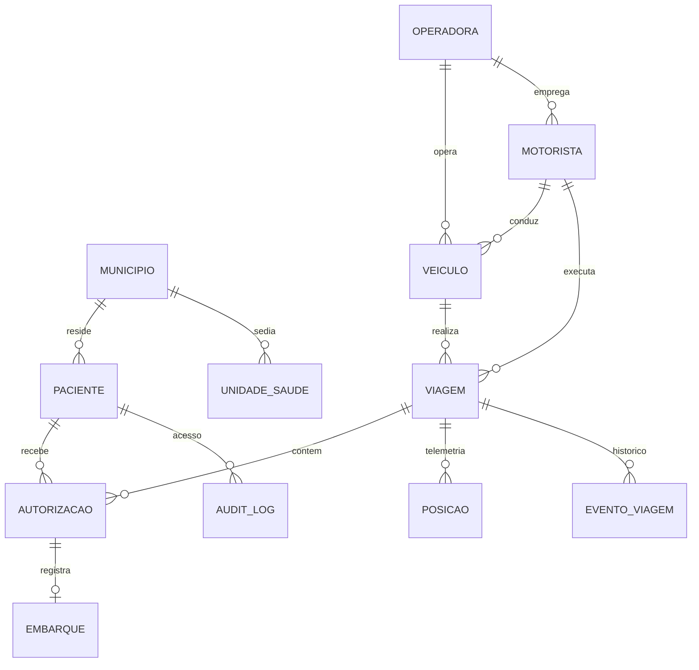
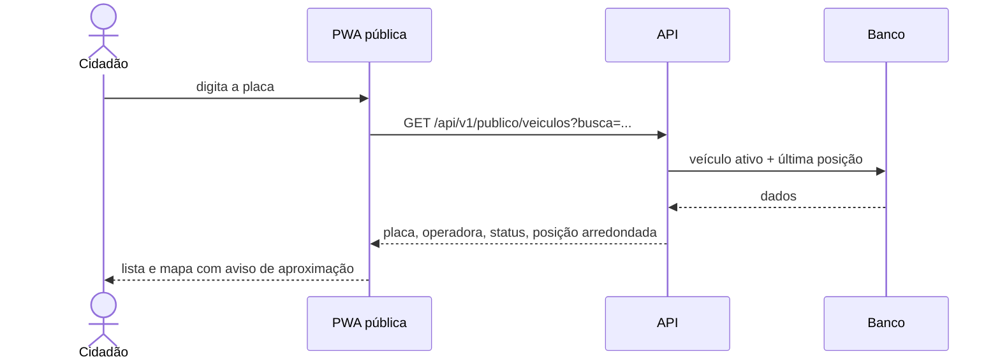
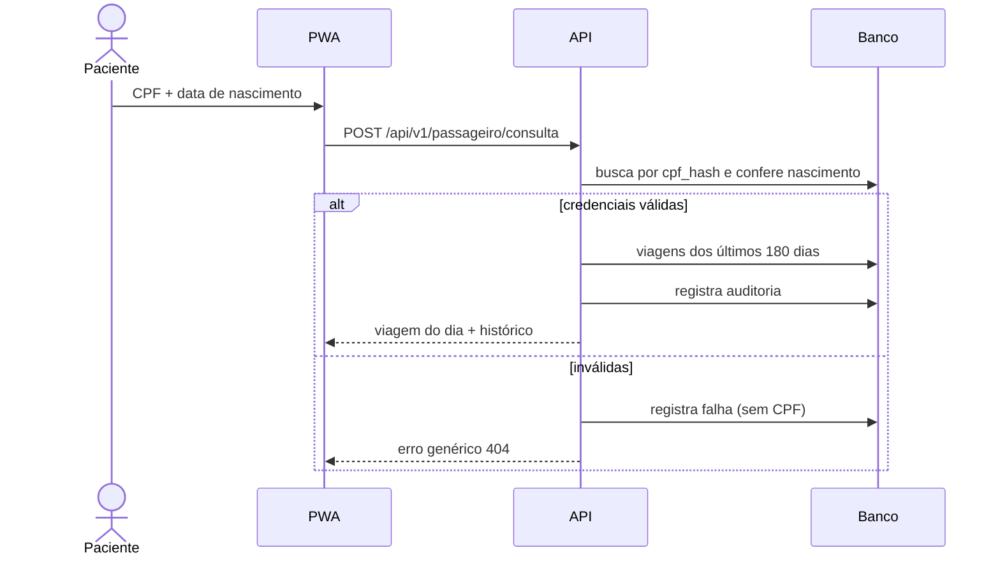
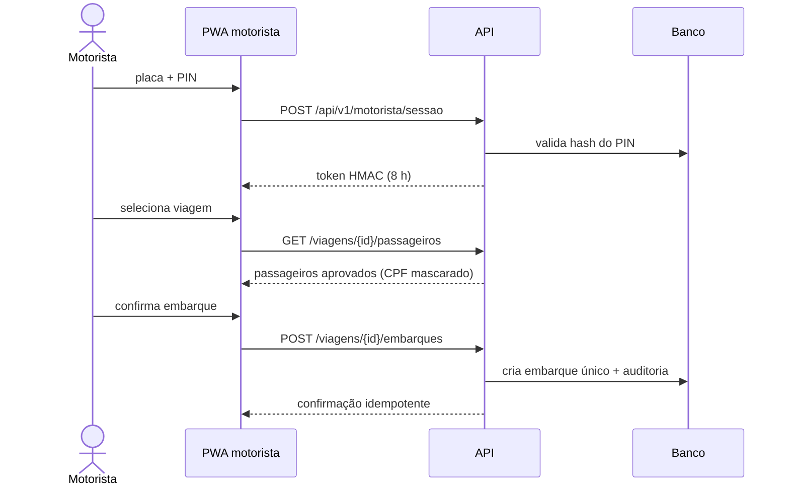
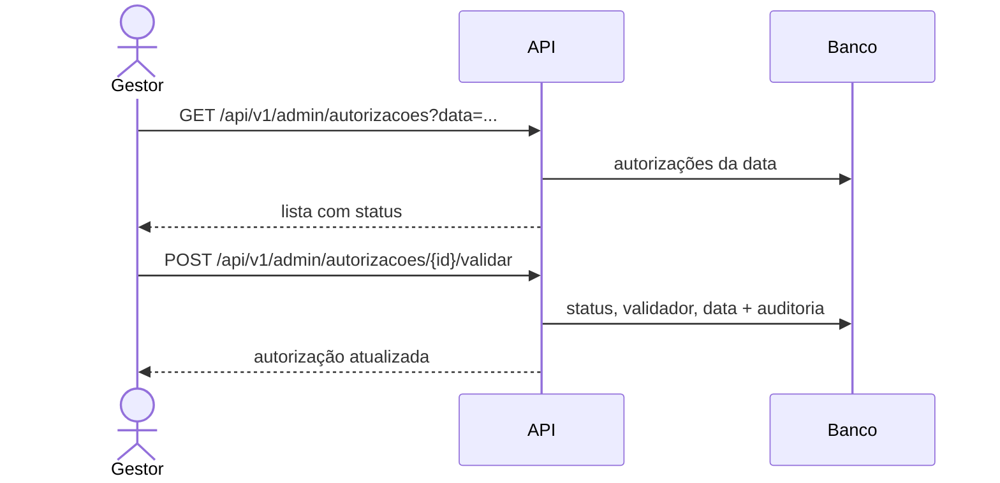

# 02 — Dossiê de engenharia reversa

**Objeto:** sistema web/mobile de rastreio logístico de passageiros do
transporte público de saúde, doravante “sistema observado”.
**Método:** caixa-preta, passivo, baseado em capturas de tela fornecidas no
contexto do TCC.
**Período da análise:** outubro de 2026.
**Produto:** inventário funcional, modelo de domínio reconstruído, fluxos,
achados e decisões incorporadas ao protótipo.

> Este documento descreve **comportamento observável**. Não afirma como o
> sistema original foi implementado, nem avalia sua conformidade legal. Cada
> afirmação é classificada como **O** (observado), **I** (inferido) ou **H**
> (hipótese), conforme [`01-metodologia.md`](01-metodologia.md).

## 1. Escopo e limites

### 1.1 O que foi analisado

- Telas de consulta pública de veículos.
- Tela de detalhe do veículo com mapa.
- Telas de consulta por CPF, com e sem agendamento no dia.
- Tela de operação do motorista.
- Duas capturas de contexto do dispositivo, sem conteúdo do sistema.

### 1.2 O que não foi analisado

- Código-fonte, binários, banco de dados, APIs internas, logs ou infraestrutura.
- Telas autenticadas de gestão municipal, relatórios e configurações.
- Aplicativos nativos, integrações, notificações e faturamento.
- Comportamento sob falha, carga, ataque ou indisponibilidade.
- Política de retenção, base legal e contratos de operação.

### 1.3 Regras éticas aplicadas

- Nenhuma tentativa de acesso não autorizado, varredura ou engenharia social.
- Nenhum dado pessoal real foi transportado para o protótipo.
- Capturas originais não são versionadas; cópias foram tarjadas e conferidas.
- O sistema original não é identificado por marca, órgão ou fornecedor.

## 2. Corpus de evidências

As cópias anonimizadas estão em
[`reverse-engineering/evidencias/`](../reverse-engineering/evidencias/), com
metadados em `manifesto.json`. Tarjas opacas removem CPF, nomes, placas e
operadoras.

| ID | Título | Conteúdo observado | Tarjas | SHA-256 (16 primeiros) |
| --- | --- | --- | --- | --- |
| **E01** | Lista pública de veículos | Busca por placa, status online/offline, operadora, última atualização | 6 placas, 3 operadoras | `9ea887398795a2b8` |
| **E02** | Detalhe do veículo no mapa | Mapa Leaflet, status, velocidade, distância, precisão, última posição | 2 placas | `0752b19ef23d6315` |
| **E03** | Consulta por CPF com histórico | CPF localizado, viagens e veículos no histórico | 2 CPF, 5 nomes, 6 placas | `d639487fdbdccfe7` |
| **E04** | Consulta por CPF sem agendamento | CPF localizado, sem autorização aprovada no dia; histórico visível | 2 CPF, 2 nomes, 2 placas | `788917b47bdcf1c9` |
| **E05** | Visão do motorista | Seleção de placa e data; nenhuma autorização municipal no dia | 2 placas | `0e93d3a89d9ca2ed` |
| **E06** | Contexto do dispositivo (launcher) | Tela inicial do aparelho; sem conteúdo do sistema | — | `7371aa0bfe31eb5d` |
| **E07** | Contexto do dispositivo (tela limpa) | Captura auxiliar; sem conteúdo do sistema | — | `9c3425c0c2bb612a` |

Os hashes completos e a origem de cada arquivo estão no manifesto. E06 e E07
não sustentam achados funcionais; permanecem apenas para rastreabilidade do
conjunto.

## 3. Inventário funcional observado

### 3.1 Consulta pública (E01, E02)

| Elemento | Observação | Nível |
| --- | --- | --- |
| Busca por placa | Campo textual com filtro por trecho | O |
| Lista de veículos | Placa, operadora, status e última atualização | O |
| Status | Indicador online/offline derivado de atualização recente | O |
| Detalhe | Mapa, posição, velocidade, precisão, distância até o usuário | O |
| Identificação do veículo | Placa, modelo e operadora visíveis | O |
| Dados de passageiros | Não aparecem na área pública | O |
| Atualização | Há referência a “última posição/atualização” | O |

**Funcionalidades reconstruídas:** busca, listagem, detalhe, mapa, status,
trilha e resumo de viagens. **Descarte deliberado:** exibir velocidade e
precisão exatas no mapa público, substituídas por valores arredondados e
indicação de aproximação.

### 3.2 Consulta do passageiro (E03, E04)

| Elemento | Observação | Nível |
| --- | --- | --- |
| Entrada | CPF como identificador de consulta | O |
| Resultado com agendamento | Dados do passageiro, viagem e veículo | O |
| Resultado sem agendamento | CPF permanece localizável; histórico continua visível | O |
| Histórico | Lista de viagens anteriores com veículo | O |
| Segundo fator | Não há evidência de senha, OTP ou data de nascimento | I |
| Finalidade/consentimento | Não há aviso visível de finalidade ou base legal | I |

**Funcionalidades reconstruídas:** consulta, viagem do dia, histórico,
mensagem de “sem agendamento”. **Correção:** CPF + data de nascimento, erro
genérico e registro de auditoria.

### 3.3 Operação do motorista (E05)

| Elemento | Observação | Nível |
| --- | --- | --- |
| Entrada | Seleção de placa e data | O |
| Conteúdo | Ausência de autorizações municipais para o dia | O |
| Autenticação | Não há tela de login na captura | I |
| Passageiros | Lista nominal não visível na captura | H |
| Registro de embarque | Não visível na captura | H |

**Funcionalidades reconstruídas:** sessão por placa + PIN, escala do dia, lista
de passageiros aprovados, embarque idempotente, eventos e GPS. **Correção:**
vínculo da sessão ao veículo e data padrão “hoje”, reduzindo seleção manual.

### 3.4 Contexto do dispositivo (E06, E07)

Sem conteúdo do sistema. Servem para documentar que o sistema é acessado por
navegador/aplicativo em dispositivo móvel, provavelmente em campo. Não foram
usadas para inferir funcionalidades.

## 4. Modelo de domínio reconstruído

### 4.1 Entidades identificadas ou necessárias

| Entidade | Justificativa | Evidência |
| --- | --- | --- |
| Município | Origem do paciente e da viagem; gestão municipal | I |
| Operadora | Exibida na lista/detalhe público | O (E01) |
| Veículo | Placa, modelo, acessibilidade e capacidade | O (E01/E02) |
| Motorista | Conduz a viagem e registra embarques | I (E05) |
| Paciente | Titular da consulta e da autorização | O (E03/E04) |
| Unidade de saúde | Destino da viagem | O (E03/E04) |
| Viagem | Liga veículo, motorista, origem, destino e horários | O (E03/E04) |
| Autorização | Vínculo municipal que valida o paciente na viagem | O (E05) |
| Embarque | Confirma que o paciente entrou no veículo | H |
| Posição | Telemetria do veículo | O (E02) |
| Evento de viagem | Início, chegada, fim, atraso, incidente | H |
| Auditoria | Acesso a dados sensíveis e ações administrativas | H |

### 4.2 Invariantes adotadas

1. Uma autorização pertence a exatamente uma viagem e a um paciente; não há
   duplicidade (`viagem_id`, `paciente_id`).
2. Um embarque só existe para autorização aprovada e é único por autorização.
3. Uma viagem só inicia após autorização municipal (ou é criada planejada).
4. Telemetria é imutável: correções geram novo ponto, não `UPDATE`.
5. Posição pública nunca inclui identificador de paciente.
6. Toda consulta sensível gera registro de auditoria.

## 5. Fluxos reconstruídos

### 5.1 Rastreamento público

### 5.2 Consulta do paciente

### 5.3 Operação do motorista

### 5.4 Validação municipal (inferida)

O fluxo 5.4 é **inferido** a partir da existência de autorizações municipais
(E05) e da necessidade operacional de aprová-las. O protótipo o implementa de
forma explícita.

## 6. Superfície de dados observada

| Dado | Onde aparece | Sensibilidade | Decisão no protótipo |
| --- | --- | --- | --- |
| Placa | E01, E02, E03, E04, E05 | Baixa (veículo) | Exposta no público |
| Operadora | E01, E02 | Baixa/Média | Exposta no público |
| Modelo/acessibilidade | E01/E02 | Baixa | Exposta no público |
| Posição | E02 | Média (movimento) | Arredondada (~11 m), trilha 12 h |
| Velocidade/precisão | E02 | Média | Arredondada, marca de aproximação |
| CPF | E03, E04 | Alto | HMAC + máscara; nunca no público |
| Nome | E03, E04 | Alto | Só para o próprio paciente / motorista da viagem / admin |
| Histórico de viagens | E03, E04 | Alto (saúde) | 180 dias, autenticado por dois fatores |
| Autorizações | E05 | Média/Alta | Painel autenticado; contagem agregada no público |
| Telemetria bruta | Não observada | Média | Ingestão autenticada; exportação auditada |

## 7. Achados

Legenda de gravidade: **Alta** (risco relevante de privacidade/segurança no
contexto), **Média** (risco condicionado), **Baixa** (melhoria de usabilidade
ou transparência). Confiança: O/I/H.

### A-01 — Consulta do passageiro baseada apenas no CPF

- **Evidência:** E03/E04 — a tela solicita CPF e retorna dados e histórico.
- **Nível:** O (entrada por CPF); I (ausência de segundo fator).
- **Risco:** CPF é identificador semiaberto; sozinho, permite que terceiros
  consultem viagens e histórico de saúde de um paciente.
- **Decisão:** exigir **CPF + data de nascimento**, mensagem de erro genérica,
  rate limit específico e auditoria de tentativas.
- **Status:** corrigido no protótipo; OTP por SMS no roadmap (I2).

### A-02 — Operação do motorista sem autenticação aparente

- **Evidência:** E05 — seleção de placa e data, sem tela de login visível.
- **Nível:** I.
- **Risco:** acesso à lista de passageiros e à operação por qualquer pessoa com
  a URL, ampliando exposição de dados de saúde.
- **Decisão:** sessão obrigatória por **placa + PIN**, token HMAC de 8 h,
  vínculo ao veículo e bloqueio de viagens de outro veículo.
- **Status:** corrigido; PIN com bloqueio progressivo no roadmap (I3).

### A-03 — Exposição de nome, CPF e placa nas telas de consulta

- **Evidência:** E03/E04 — histórico e identificação do paciente/veículo.
- **Nível:** O (exibição); I (armazenamento em claro).
- **Risco:** captura de tela, ombro digital e logs podem expor dados pessoais.
- **Decisão:** CPF sempre mascarado (`***.***.***-NN`); nome completo apenas
  para o titular, motorista da viagem e administração; nenhum dado pessoal no
  endpoint público; logs sem CPF.
- **Status:** mitigado; a hipótese de armazenamento em claro não pôde ser
  verificada e não é afirmada.

### A-04 — Contagem de autorizações permite inferir fluxo de pacientes

- **Evidência:** E01/E02 (listagem e detalhe de veículos) + existência de
  autorizações por viagem (E05).
- **Nível:** I.
- **Risco:** cruzar placa, data e quantidade de autorizações pode revelar
  volume de pacientes e padrões de atendimento, mesmo sem nomes.
- **Decisão:** o público recebe apenas **agregado por viagem**, sem identidade;
  rate limit; documentação do risco residual. A contagem é mantida porque a
  operação a usa para conferir a escala.
- **Status:** mitigado parcialmente; risco residual aceito e registrado
  (ver [`07-seguranca-lgpd.md`](07-seguranca-lgpd.md)).

### A-05 — Posição em tempo real com precisão não minimizada

- **Evidência:** E02 — mapa com velocidade, precisão e distância.
- **Nível:** O.
- **Risco:** localização exata de veículo de saúde pode ser usada para
  vigilância, stalking ou identificação indireta de pacientes.
- **Decisão:** arredondar coordenadas para 4 casas (~11 m), limitar a trilha a
  12 h, no máximo 200 pontos, e sinalizar `posicao_aproximada`.
- **Status:** corrigido.

### A-06 — Histórico amplo sem janela de retenção explícita

- **Evidência:** E03 — histórico de viagens anteriores.
- **Nível:** O (existência); H (retenção > 180 dias).
- **Risco:** acúmulo indefinido de dados de saúde e deslocamento.
- **Decisão:** consulta limitada a **180 dias** e 30 registros; trilha pública
  de 12 h; retenção e descarte no roadmap (I7).
- **Status:** mitigado parcialmente.

### A-07 — Ausência de finalidade e consentimento visíveis

- **Evidência:** E03/E04 — consulta sem aviso de finalidade/base legal.
- **Nível:** I.
- **Risco:** tratamento sem transparência, dificultando exercício de direitos.
- **Decisão:** aviso de privacidade na PWA, campo `consentimento_em`, trilha de
  auditoria e documentação ROPA.
- **Status:** mitigado; texto jurídico definitivo é responsabilidade do
  controlador.

### A-08 — Falta de feedback claro para “sem autorização no dia”

- **Evidência:** E04/E05 — resultado sem agendamento e visão do motorista sem
  autorizações.
- **Nível:** O.
- **Risco:** paciente e motorista não sabem se é ausência de autorização, erro
  ou atraso de sincronização.
- **Decisão:** campo explícito `possui_agendamento`, estado vazio orientativo e
  status da autorização na lista do motorista.
- **Status:** corrigido.

### A-09 — Seleção manual de placa/data no motorista

- **Evidência:** E05 — placa e data selecionáveis.
- **Nível:** O.
- **Risco:** erro operacional (veículo/data errados), embarque em viagem
  incorreta.
- **Decisão:** sessão vinculada ao veículo; data padrão “hoje”; servidor valida
  que a viagem pertence ao veículo.
- **Status:** corrigido.

### A-10 — Acessibilidade do veículo não evidenciada na lista

- **Evidência:** E01/E02 — não há indicação observável de acessibilidade.
- **Nível:** I.
- **Risco:** pessoa com deficiência não consegue planejar o embarque.
- **Decisão:** expor `acessivel` no público e no resumo do veículo.
- **Status:** melhorado.

### 7.1 O que o sistema observado faz bem

Reconhecer acertos é parte da análise:

- busca pública simples, sem cadastro, com resposta rápida;
- mapa com status e última atualização, reduzindo incerteza;
- consulta por CPF de baixa fricção para o paciente;
- visão diária para o motorista, alinhada ao turno;
- separação clara entre área pública e consulta individual.

O protótipo preserva essas qualidades e acrescenta controles de privacidade.

## 8. Hipóteses e lacunas

| # | Hipótese/lacuna | Impacto no projeto | Como foi tratada |
| --- | --- | --- | --- |
| H1 | O sistema original autentica o motorista por outro meio não visível | A-02 pode ser falso positivo | Protótipo adota PIN + token; risco documentado |
| H2 | O CPF é armazenado de forma pseudonimizada | A-03 pode ser menos grave | Protótipo usa HMAC; não afirma sobre o original |
| H3 | Há retenção definida fora da interface | A-06 pode ser falso positivo | Janela de 180 dias no protótipo |
| H4 | A contagem de autorizações não é pública | A-04 pode não se aplicar | Mantida apenas como agregado e documentada |
| H5 | Existe integração com regulação municipal | Fluxo 5.4 é simplificado | Endpoint administrativo explícito |
| H6 | Notificações/OTP existem em outro canal | A-01 pode ser parcialmente mitigado | OTP previsto no roadmap |
| H7 | O sistema tem app nativo com telemetria própria | Ingestão é simplificada | Gateway + app do motorista |
| H8 | A base legal é definida em contrato/portaria | Fora do alcance da tela | ROPA e governança documentadas |

## 9. Comparação: observado × protótipo

| Capacidade | Observado | Protótipo | Diferença deliberada |
| --- | --- | --- | --- |
| Busca pública por placa | Sim | Sim | Posição aproximada |
| Status online/offline | Sim | Sim | Limiar configurável (300 s) |
| Mapa | Sim (Leaflet) | Sim (Leaflet + fallback) | Sem chave de terceiros |
| Trilha | Indício | Sim, 12 h | Minimização |
| Consulta do paciente | CPF | CPF + nascimento | Segundo fator |
| Histórico | Sim | 180 dias / 30 itens | Retenção |
| Operação do motorista | Placa + data | Placa + PIN, sessão | Autenticação |
| Passageiros | Inferido | Lista aprovada, CPF mascarado | Minimização |
| Embarque | Inferido | Idempotente + auditoria | Integridade |
| Autorizações | Sim (E05) | Listagem + validação | Fluxo explícito |
| Painel/KPIs | Fora das capturas | Sim | OTIF e atraso |
| Auditoria | Não observada | Sim | LGPD art. 37 |
| Dados | Reais no original | 100% sintéticos | Ética |

## 10. Conclusão do dossiê

As evidências permitem reconstruir com segurança o **núcleo funcional**:
rastreamento público por placa, consulta individual por CPF, visão diária do
motorista e existência de autorizações municipais. Não permitem afirmar nada
sobre implementação, retenção, autenticação real ou integrações.

O protótipo demonstra que é possível preservar a utilidade operacional e, ao
mesmo tempo, elevar o padrão de privacidade: pseudonimização, segundo fator,
minimização de localização, autenticação de serviço, auditoria e transparência.
As lacunas estão declaradas, não escondidas; os riscos residuais (A-04, A-06,
PIN curto, chave administrativa estática) estão registrados em
[`07-seguranca-lgpd.md`](07-seguranca-lgpd.md) e no roadmap.
