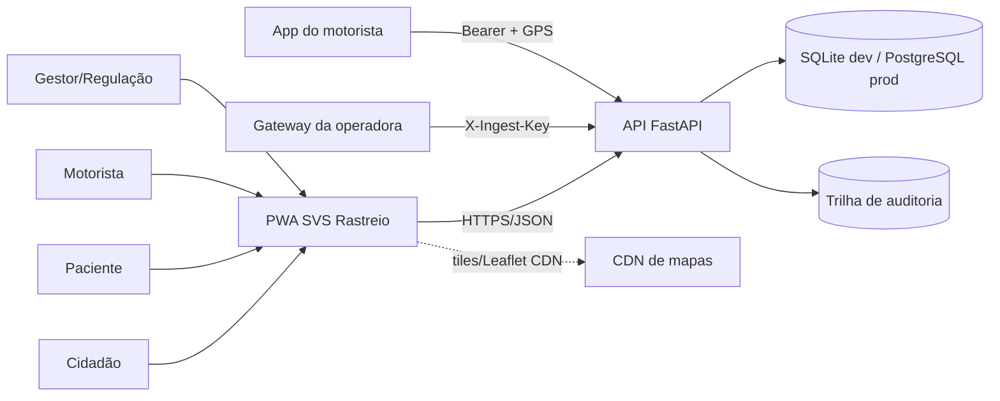
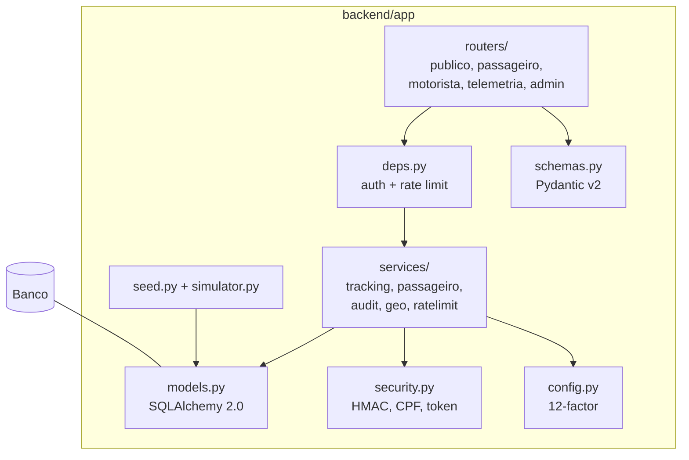
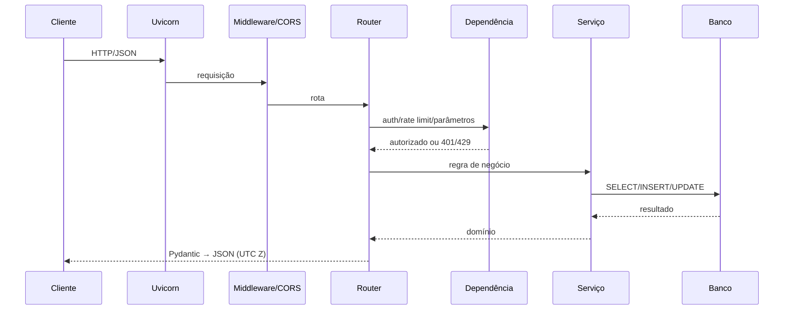

# 04 — Arquitetura

## 1. Princípios

1. **Monólito modular** — um processo FastAPI, camadas explícitas; complexidade
   operacional mínima para um protótipo acadêmico.
2. **API como fonte da verdade** — a PWA não replica regras de negócio; toda
   validação crítica acontece no servidor.
3. **Privacidade por padrão** — os contratos públicos são pobres em dados por
   decisão, não por esquecimento.
4. **Portabilidade** — SQLite em desenvolvimento, PostgreSQL em produção, sem
   dependência de fornecedor de nuvem.
5. **Reprodutibilidade** — um comando sobe o sistema; seed determinístico;
   artefatos gerados por script.
6. **Evolução incremental** — cada incremento do roadmap entrega valor e pode
   ser revertido sem reescrever o núcleo.

## 2. Contexto (C4 nível 1)



## 3. Containers (C4 nível 2)

| Container | Responsabilidade | Tecnologia | Estado |
| --- | --- | --- | --- |
| **PWA** | Interface pública, paciente, motorista e gestão; service worker | HTML/CSS/JS, Leaflet | Servida pela própria API (`/`) |
| **API** | Contratos REST, autenticação, regras, persistência | FastAPI + Uvicorn | 1 processo em dev |
| **Banco** | Dados operacionais e telemetria | SQLite / PostgreSQL 16+ | Fonte da verdade |
| **Auditoria** | Registro de acessos e ações | Tabela `audit_log` | Mesmo banco |
| **Simulador** | Gera telemetria para demonstração | Python + `urllib` | Fora de produção |
| **Proxy** | TLS, compressão, cabeçalhos e rate limit de borda | Nginx/Traefik | Produção |

## 4. Componentes do backend (C4 nível 3)



### 4.1 Camadas e regras

| Camada | Pode | Não pode |
| --- | --- | --- |
| `routers/` | Validar transporte, orquestrar, mapear erros HTTP | Conter regra de negócio complexa |
| `services/` | Regras, consultas, cálculos, auditoria | Depender de `Request`/HTTP |
| `models/` | Mapeamento ORM, constraints | Conhecer HTTP ou Pydantic |
| `schemas/` | Contrato de entrada/saída e validação | Acessar banco |
| `security/` | Criptografia, normalização, tokens | Persistir dados |

### 4.2 Arquivos-chave

| Arquivo | Papel |
| --- | --- |
| `backend/app/main.py` | Cria a app, monta routers e estáticos, healthz |
| `backend/app/config.py` | Configuração imutável por processo e validação de produção |
| `backend/app/db.py` | Engine, sessão, PRAGMA do SQLite |
| `backend/app/models.py` | 12 tabelas, constraints e índices |
| `backend/app/schemas.py` | Contratos Pydantic e serialização UTC `Z` |
| `backend/app/security.py` | CPF, placa, PIN, token HMAC, hash de IP |
| `backend/app/routers/deps.py` | Chaves de serviço, Bearer, rate limit, IP |
| `backend/app/services/tracking.py` | Status, posição pública, trilha, resumo |
| `backend/app/services/passageiro.py` | Localização por hash + montagem da consulta |
| `backend/app/services/audit.py` | Registro de auditoria |
| `backend/app/services/geo.py` | Distância (Haversine) e arredondamento |
| `backend/app/seed.py` | Cenário sintético canônico |
| `backend/app/simulator.py` | Simulador embutido (módulo) |
| `scripts/simular_telemetria.py` | Simulador standalone com descoberta de viagem |

## 5. Fluxo de uma requisição



Boas práticas aplicadas:

- Validação de entrada **antes** da regra (Pydantic).
- Erros de domínio convertidos em HTTP apenas no router.
- `db.commit()` explícito após auditoria.
- Nenhum ORM vaza para o contrato público.
- Datas sem fuso são tratadas como UTC e serializadas com sufixo `Z`.

## 6. Modelo de implantação

### 6.1 Desenvolvimento

```text
┌──────────────┐      HTTP :8000       ┌──────────────────┐
│ Navegador    │ ────────────────────▶ │ Uvicorn (reload) │
│ (PWA)        │ ◀──────────────────── │ FastAPI          │
└──────────────┘                       └────────┬─────────┘
                                                │ SQLAlchemy
                                       ┌────────▼─────────┐
                                       │ data/svs.db      │
                                       │ (SQLite, WAL)    │
                                       └──────────────────┘
```

- `SVS_AUTO_SEED=1` cria o cenário se o banco estiver vazio.
- `SVS_AUTO_CREATE=1` cria as tabelas a partir dos modelos.
- Simulador em processo separado envia telemetria via HTTP.

### 6.2 Produção de referência

```text
Internet
  │ TLS
  ▼
WAF/CDN ──▶ Proxy reverso (Nginx/Traefik)
                │
                ├──▶ API (N réplicas Uvicorn/Gunicorn)
                │        │
                │        ├──▶ PostgreSQL 16+ (primário + réplica)
                │        └──▶ Redis (rate limit/sessão de borda)
                │
                └──▶ Estáticos versionados (pode ser CDN)
```

- `SVS_ENV=prod` desativa auto-create/auto-seed e exige segredos próprios.
- Migrações com Alembic (roadmap I4); o DDL de referência está em
  [`db/schema.sql`](../db/schema.sql).
- PostGIS é opcional para consultas geoespaciais; o protótipo calcula distância
  em memória (Haversine) para manter portabilidade.
- Backups diários, retenção definida e teste de restauração.
- Telemetria pode ser particionada por mês em produção.

Veja [`infra/`](../infra/) para Dockerfile e `docker-compose.yml`.

## 7. Decisões de arquitetura

| ADR | Decisão |
| --- | --- |
| [0001](adr/0001-monolito-fastapi.md) | Monólito modular FastAPI em vez de microserviços |
| [0002](adr/0002-sqlite-dev-postgres-prod.md) | SQLite em dev, PostgreSQL em produção |
| [0003](adr/0003-pseudonimizacao-cpf.md) | HMAC-SHA256 + pepper para CPF e PIN |
| [0004](adr/0004-sessao-motorista-stateless.md) | Token de motorista stateless assinado |
| [0005](adr/0005-pwa-sem-build.md) | PWA vanilla sem etapa de build |
| [0006](adr/0006-minimizacao-localizacao.md) | Arredondamento e janela de trilha |
| [0007](adr/0007-chaves-de-servico.md) | Chaves estáticas para ingestão e administração |

## 8. Atributos de qualidade

| Atributo | Tática | Limite atual |
| --- | --- | --- |
| **Segurança** | HMAC, segundo fator, rate limit, chaves, validação | Chaves estáticas; sem MFA |
| **Privacidade** | Minimização, máscara, retenção, auditoria | Retenção automatizada pendente |
| **Desempenho** | Índices, limites de consulta, resposta enxuta | Sem cache distribuído |
| **Disponibilidade** | Health check, stateless API, banco gerenciável | Sem HA no protótipo |
| **Escalabilidade** | API sem estado, Postgres, limites | Rate limit em memória |
| **Manutenibilidade** | Camadas, tipagem, lint, testes, ADRs | Sem migrações ainda |
| **Portabilidade** | Docker, 12-factor, SQL padrão | PostGIS opcional |
| **Observabilidade** | `audit_log`, healthz, logs | Sem métricas/tracing |

## 9. Estimativas de capacidade (ordem de grandeza)

Premissas para a fase de produção: 50 veículos, 1 ponto a cada 10 s, 10 h de
operação por dia.

- Telemetria: `50 × 6 × 60 × 10 ≈ 180.000` pontos/dia (~5,4 milhões/mês).
- Leituras públicas: 10–20× a telemetria em pico de manhã.
- PostgreSQL com índice `(veiculo_id, capturada_em)` atende com folga; a
  exportação CSV é limitada a 50 mil linhas por chamada.
- O gargalo esperado não é o banco, e sim a **borda** (rate limit e cache de
  leitura). Por isso o roadmap prioriza Redis/CDN.

## 10. Falhas e degradação

| Falha | Comportamento | Mitigação |
| --- | --- | --- |
| GPS sem sinal | Veículo fica `OFFLINE` após 300 s | Última posição + idade exibidas |
| Leaflet/CDN indisponível | Fallback textual com coordenadas | `comum.js` |
| Banco indisponível | Erro 500; healthz ainda responde | Pool, timeout, alerta |
| Ingestão duplicada | Pontos repetidos (append-only) | Deduplicação no gateway |
| Telemetria atrasada | Aceita até 24 h no passado | Janela validada |
| Exportação grande | Limitada a 50 mil linhas | Paginação/particionamento |
| Rate limit atingido | HTTP 429 + `Retry-After` | Limite por IP e por rota |
| Segredo padrão em prod | Processo não inicia | `Settings.validar` |

## 11. O que não faz parte da arquitetura

- Microsserviços, Kafka, event sourcing ou CQRS.
- Kubernetes, service mesh ou multi-região.
- Machine learning em tempo real para previsão de chegada (ETA).
- Aplicativo nativo, notificações push ou SMS.
- Integração com prontuário, faturamento ou regulação externa.
- Autenticação federada gov.br.

Essas escolhas mantêm o artefato auditável e compatível com o escopo do TCC.
