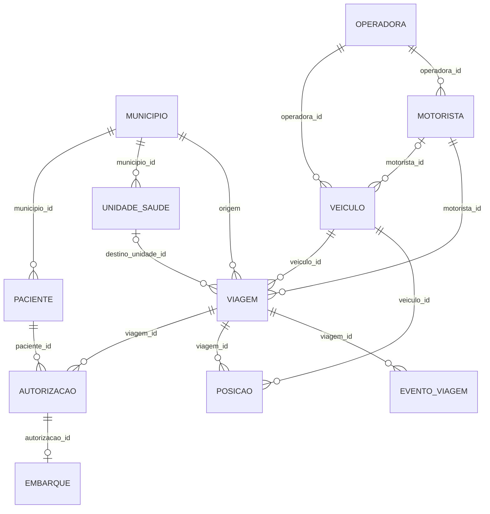

# 05 — Modelo de dados

## 1. Visão geral

O modelo tem **12 tabelas** e foi desenhado para separar claramente:

- **cadastro** (município, operadora, veículo, motorista, paciente, unidade);
- **operação** (viagem, autorização, embarque, evento);
- **telemetria** (posição, imutável);
- **governança** (auditoria).

DDL de referência para PostgreSQL:
[`db/schema.sql`](../db/schema.sql). Fonte canônica: `backend/app/models.py`.
Snapshot sintético: [`db/seed.sql`](../db/seed.sql).

## 2. Diagrama entidade-relacionamento

## 3. Dicionário de dados

### 3.1 `municipio`

| Coluna | Tipo | Regra |
| --- | --- | --- |
| `id` | serial | PK |
| `codigo_ibge` | varchar(7) | único, obrigatório |
| `nome` | varchar(120) | indexado |
| `uf` | varchar(2) | obrigatório |

### 3.2 `operadora`

| Coluna | Tipo | Regra |
| --- | --- | --- |
| `id` | serial | PK |
| `nome` | varchar(120) | único |
| `cnpj` | varchar(18) | opcional (não usado no seed) |
| `contato` | varchar(160) | opcional |
| `ativa` | boolean | padrão `true` |

### 3.3 `motorista`

| Coluna | Tipo | Regra |
| --- | --- | --- |
| `id` | serial | PK |
| `nome` | varchar(120) | obrigatório |
| `cpf_hash` | varchar(64) | único, HMAC-SHA256 |
| `cpf_mascarado` | varchar(14) | `***.***.***-NN` |
| `pin_hash` | varchar(64) | HMAC do PIN |
| `cnh_categoria` | varchar(5) | padrão `D` |
| `operadora_id` | FK | `operadora.id` |
| `ativo` | boolean | padrão `true` |
| `criado_em` | timestamp | UTC ingênuo |

### 3.4 `veiculo`

| Coluna | Tipo | Regra |
| --- | --- | --- |
| `id` | serial | PK |
| `placa` | varchar(8) | único, indexado, Mercosul ou antiga |
| `modelo` | varchar(80) | obrigatório |
| `tipo` | varchar(30) | `VAN`, `MICROONIBUS` etc. |
| `capacidade` | integer | `> 0` |
| `acessivel` | boolean | padrão `true` |
| `ativo` | boolean | padrão `true` |
| `operadora_id` | FK | obrigatório |
| `motorista_id` | FK | opcional (motorista padrão) |

### 3.5 `paciente`

| Coluna | Tipo | Regra |
| --- | --- | --- |
| `id` | serial | PK |
| `nome` | varchar(120) | obrigatório; não exposto no público |
| `cpf_hash` | varchar(64) | único, indexado |
| `cpf_mascarado` | varchar(14) | exibição |
| `data_nascimento` | date | segundo fator |
| `telefone_mascarado` | varchar(20) | opcional |
| `municipio_id` | FK | obrigatório |
| `consentimento_em` | timestamp | opcional, auditoria de consentimento |
| `ativo` | boolean | padrão `true` |

### 3.6 `unidade_saude`

| Coluna | Tipo | Regra |
| --- | --- | --- |
| `id` | serial | PK |
| `nome` | varchar(160) | obrigatório |
| `tipo` | varchar(30) | `UBS`, `UPA`, `HOSPITAL`, `CAPS`, `LABORATORIO`, `CER` |
| `municipio_id` | FK | obrigatório |
| `latitude` / `longitude` | float | faixas válidas |

### 3.7 `viagem`

| Coluna | Tipo | Regra |
| --- | --- | --- |
| `id` | serial | PK |
| `data` | date | indexado |
| `veiculo_id` | FK | indexado |
| `motorista_id` | FK | obrigatório |
| `origem_municipio_id` | FK | obrigatório |
| `destino_unidade_id` | FK | opcional |
| `destino_texto` | varchar(160) | denormalização para exibição |
| `trajeto` | varchar(15) | `IDA`, `VOLTA`, `IDA_E_VOLTA` |
| `status` | varchar(20) | `PLANEJADA`, `AUTORIZADA`, `EM_ANDAMENTO`, `CONCLUIDA`, `CANCELADA` |
| `partida_prevista` | timestamp | obrigatório |
| `retorno_previsto` | timestamp | opcional |
| `iniciada_em` / `concluida_em` | timestamp | preenchidos por evento |
| `observacao` | text | opcional |

Índice composto `(veiculo_id, data)` para a escala diária.

### 3.8 `autorizacao`

| Coluna | Tipo | Regra |
| --- | --- | --- |
| `id` | serial | PK |
| `viagem_id` | FK | `ON DELETE CASCADE`, indexado |
| `paciente_id` | FK | indexado |
| `numero` | varchar(40) | único |
| `status` | varchar(20) | `PENDENTE`, `APROVADA`, `NEGADA`, `CANCELADA` |
| `origem` | varchar(20) | `SMS`, `OFICIO`, `SISTEMA` |
| `emitida_em` | timestamp | padrão agora |
| `validada_em` | timestamp | opcional |
| `validada_por` | varchar(120) | opcional |

Restrição `UNIQUE (viagem_id, paciente_id)` impede duplicidade.

### 3.9 `embarque`

| Coluna | Tipo | Regra |
| --- | --- | --- |
| `id` | serial | PK |
| `autorizacao_id` | FK | único, `ON DELETE CASCADE` |
| `embarcado_em` | timestamp | padrão agora |
| `desembarcado_em` | timestamp | opcional |
| `metodo` | varchar(15) | `QRCODE`, `CPF`, `MANUAL` |
| `registrado_por` | varchar(120) | nome do motorista |

### 3.10 `posicao` (append-only)

| Coluna | Tipo | Regra |
| --- | --- | --- |
| `id` | serial | PK |
| `veiculo_id` | FK | indexado |
| `viagem_id` | FK | opcional, indexado |
| `latitude` / `longitude` | float | faixas válidas |
| `velocidade_kmh` | float | `>= 0` |
| `rumo` | float | 0–360 (validação de entrada) |
| `precisao_m` | float | padrão 10 |
| `fonte` | varchar(20) | `APP_MOTORISTA`, `GATEWAY`, `SIMULADOR` |
| `capturada_em` | timestamp | indexado |
| `recebida_em` | timestamp | padrão agora |

Índice composto `(veiculo_id, capturada_em)` para “última posição” e trilha.
Não há `UPDATE`/`DELETE` no fluxo da aplicação.

### 3.11 `evento_viagem`

| Coluna | Tipo | Regra |
| --- | --- | --- |
| `id` | serial | PK |
| `viagem_id` | FK | `ON DELETE CASCADE`, indexado |
| `tipo` | varchar(20) | `INICIO`, `CHEGADA_DESTINO`, `FIM`, `ATRASO`, `INCIDENTE`, `OBSERVACAO` |
| `observacao` | text | opcional |
| `ator` | varchar(120) | quem registrou |
| `criado_em` | timestamp | padrão agora |

### 3.12 `audit_log`

| Coluna | Tipo | Regra |
| --- | --- | --- |
| `id` | serial | PK |
| `ator_tipo` | varchar(20) | `PASSAGEIRO`, `MOTORISTA`, `ADMIN` |
| `ator_ref` | varchar(80) | id ou identificador |
| `acao` | varchar(60) | indexado |
| `recurso` | varchar(60) | entidade afetada |
| `recurso_id` | varchar(60) | id |
| `ip_hash` | varchar(64) | HMAC do IP |
| `detalhe` | text | sem CPF/nome |
| `criado_em` | timestamp | indexado |

## 4. Invariantes e integridade

| # | Invariante | Mecanismo |
| --- | --- | --- |
| I1 | Placa única e normalizada | `UNIQUE` + `normalizar_placa` |
| I2 | CPF único e pseudonimizado | `UNIQUE(cpf_hash)` |
| I3 | Uma autorização por paciente/viagem | `UNIQUE(viagem_id, paciente_id)` |
| I4 | Um embarque por autorização | `UNIQUE(autorizacao_id)` |
| I5 | Embarque só com autorização aprovada | regra no serviço + 409 |
| I6 | Viagem do motorista pertence ao veículo da sessão | regra no serviço + 404 |
| I7 | Telemetria imutável | convenção append-only |
| I8 | Coordenadas válidas | `CHECK` |
| I9 | Capacidade positiva | `CHECK` |
| I10 | Status/tipo dentro do vocabulário | `CHECK` |

> A imutabilidade da telemetria é garantida **pela aplicação** (não há rota de
> alteração). Em produção, recomenda-se reforçar com permissão `INSERT` apenas
> para o usuário de ingestão e `REVOKE UPDATE/DELETE`.

## 5. Estratégia de retenção (proposta)

| Dado | Retenção | Fundamento |
| --- | --- | --- |
| Telemetria bruta | 90 dias | Operação e auditoria; depois agregar |
| Trilha pública | 12 h (consulta) | Minimização |
| Viagens/autorizações | 5 anos | Prestação de contas pública |
| Embarques | 5 anos | Comprovação de atendimento |
| Consulta do paciente | 180 dias (visão) | Minimização no front |
| Auditoria | 5 anos | LGPD art. 37 |
| Backups | 30 dias | Recuperação |

Prazos são **proposta acadêmica**; a definição final cabe ao controlador, com
parecer jurídico e tabela de temporalidade.

## 6. Dados sintéticos

O seed cria:

| Entidade | Quantidade |
| --- | --- |
| Municípios | 5 (Santos, São Vicente, Cubatão, São Paulo, Diadema) |
| Operadoras | 2 (fictícias, sufixo “demo”) |
| Motoristas | 4 |
| Veículos | 4 (`SVS1A23`, `SVS2B34`, `DEM0C56`, `TST9D87`) |
| Pacientes | 3 (Alfa, Beta, Gama) |
| Unidades de saúde | 5 |
| Viagens | 4 (hoje, ontem e 30 dias atrás) |
| Autorizações | 6 |
| Embarques | 1 |
| Posições | 27 |

Os CPFs são gerados de `900000001`–`900000103` com dígitos verificadores
válidos. As datas são relativas ao dia da execução, exceto no snapshot
`db/seed.sql`, que registra a data de referência no cabeçalho.

## 7. Evolução e migração

- **Desenvolvimento:** `Base.metadata.create_all` via `SVS_AUTO_CREATE=1`.
- **Produção:** Alembic (roadmap I4), com revisões versionadas e *backfill*
  separado.
- **PostgreSQL:** `db/schema.sql` é gerado por
  [`scripts/gerar_schema_sql.py`](../scripts/gerar_schema_sql.py); não editar à
  mão.
- **Mudanças compatíveis:** adicionar coluna anulável, criar índice
  concorrente, nova tabela.
- **Mudanças incompatíveis:** expandir/contrair em duas etapas, com período de
  compatibilidade.
- **PostGIS:** extensão opcional para consultas por raio; o protótipo mantém
  cálculo em memória para não exigir GDAL/PostGIS no ambiente acadêmico.

## 8. Privacidade no modelo

| Técnica | Onde |
| --- | --- |
| Pseudonimização | `paciente.cpf_hash`, `motorista.cpf_hash`, `audit_log.ip_hash` |
| Minimização | ausência de CPF/nome em tabelas públicas; posição arredondada na saída |
| Máscara | `cpf_mascarado`, `telefone_mascarado` |
| Finalidade | `consentimento_em`, `audit_log.acao/recurso` |
| Segregação | telemetria separada de identidade do paciente |
| Retenção | janelas de consulta e proposta de temporalidade |

O modelo **não** armazena diagnóstico, prontuário, exames ou dado clínico. A
vinculação a uma unidade de saúde já é considerada dado sensível por inferência
e, por isso, tratada com acesso autenticado e auditoria.
