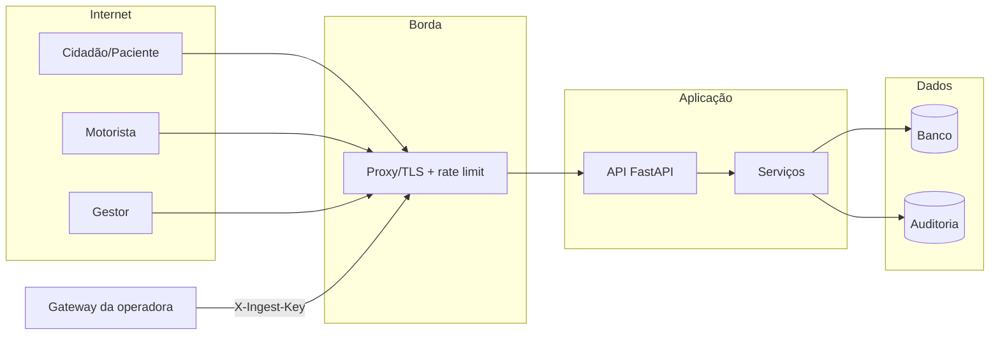

# 07 — Segurança e LGPD

## 1. Resumo executivo

O protótipo trata **dados pessoais de saúde** (vinculação de um paciente a uma
viagem e a uma unidade de saúde) e **dados de localização de veículos**. Esses
dados exigem cuidado proporcional: ainda que o veículo não identifique
diretamente o paciente, o cruzamento com horários, placas e autorizações pode
revelar condição de saúde e padrões de deslocamento.

A postura adotada é **privacidade por padrão e por projeto**:

1. não armazenar CPF em texto claro;
2. exigir dois fatores para consultar dados do paciente;
3. expor o mínimo possível na área pública;
4. limitar localização e histórico no tempo e na precisão;
5. autenticar serviços e registrar acessos;
6. falhar de forma genérica, sem revelar existência de cadastro;
7. recusar configuração insegura em produção.

## 2. Ativos e classificações

| Ativo | Classificação | Onde vive | Impacto se vazado |
| --- | --- | --- | --- |
| CPF do paciente | Pessoal sensível por contexto | `cpf_hash`, `cpf_mascarado` | Reidentificação, fraude, estigma |
| Nome do paciente | Pessoal | `paciente.nome` | Exposição direta |
| Data de nascimento | Pessoal | `paciente.data_nascimento` | Segundo fator fraco |
| Viagem/autorização | Saúde (inferência) | `viagem`, `autorizacao` | Revela tratamento/deslocamento |
| Localização do veículo | Pessoal/estratégico | `posicao` | Vigilância, stalking, inferência |
| PIN do motorista | Credencial | `pin_hash` | Acesso à operação |
| Token de sessão | Credencial | Cliente (sessionStorage) | Acesso à operação |
| Chaves de serviço | Segredo | Variáveis de ambiente | Ingestão/painel indevidos |
| Trilha de auditoria | Sensível | `audit_log` | Represália, vazamento |
| Evidências anonimizadas | Restrito | `reverse-engineering/` | Reidentificação se mal tarjado |

## 3. Atores e fronteiras de confiança

Fronteiras: navegador ↔ borda (TLS), borda ↔ API, API ↔ banco, gateway ↔ API.
O banco não é exposto à internet. O protótipo local não tem TLS; em produção,
TLS é obrigatório na borda.

## 4. Modelo de ameaças (STRIDE)

| Categoria | Cenário | Controle | Residual |
| --- | --- | --- | --- |
| **Spoofing** | Alguém se passa por motorista | Placa + PIN; token assinado | PIN de 4 dígitos, sem bloqueio progressivo |
| **Spoofing** | Gateway falso envia telemetria | `X-Ingest-Key` | Chave estática, sem rotação |
| **Tampering** | Alterar posição histórica | Sem rota de update; append-only | Sem permissão de banco restritiva |
| **Tampering** | Adulterar token | HMAC + `compare_digest` | Segredo comprometido invalida tudo |
| **Repudiation** | Negar consulta/validação | `audit_log` com ator, ação e IP hash | Log não é WORM |
| **Information disclosure** | Enumerar CPFs | Erro genérico + rate limit | Segundo fator fraco (nascimento) |
| **Information disclosure** | Rastrear veículo com precisão | Arredondamento ~11 m, trilha 12 h | Correlação com horários |
| **Information disclosure** | Ler dados no banco | HMAC de CPF, máscara | Sem criptografia em repouso no protótipo |
| **Denial of service** | Inundar consulta pública | Rate limit por IP | Em memória, por processo |
| **Elevation of privilege** | Usar chave admin vazada | Chave separada, auditoria | Sem RBAC/MFA/escopo |
| **Elevation of privilege** | Acessar viagem de outro veículo | Vínculo sessão-veículo | — |

## 5. Controles implementados

| Controle | Implementação | Evidência |
| --- | --- | --- |
| Pseudonimização de CPF | `HMAC-SHA256(cpf, pepper)` | `security.hash_cpf`, `models.paciente.cpf_hash` |
| Pseudonimização de PIN | `HMAC-SHA256(pin, pepper)` | `security.hash_pin` |
| Máscara de CPF | `***.***.***-NN` | `security.mascarar_cpf` |
| Segundo fator | Data de nascimento exata | `services/passageiro.localizar_paciente` |
| Erro genérico | Mesma mensagem para causas distintas | `routers/passageiro.py` |
| Rate limit | Janela deslizante em memória | `services/ratelimit.py`, `deps.py` |
| Token de motorista | HMAC + expiração | `security.emitir_token_motorista` |
| Chaves de serviço | Comparação em tempo constante | `deps.exigir_admin/exigir_chave_ingestao` |
| Minimização de posição | 4 casas decimais (~11 m) | `SVS_POSITION_DECIMALS` |
| Janela de trilha | 12 h, máx. 200 pontos | `services/tracking.trilha_publica` |
| Janela de histórico | 180 dias, máx. 30 itens | `services/passageiro` |
| Append-only | Sem rota de alteração de posição | `models.Posicao` |
| Auditoria | `audit_log` com IP pseudonimizado | `services/audit.py` |
| Validação temporal | −24 h / +5 min | `routers/telemetria.py` |
| Vínculo viagem-veículo | Checagem no serviço | `routers/telemetria.py`, `motorista.py` |
| Configuração segura | Recusa padrões em `prod` | `config.Settings.validar` |
| CORS restrito | Lista explícita, métodos GET/POST | `main.py` |

## 6. LGPD — princípios e implementação

| Princípio (art. 6º) | Como aparece |
| --- | --- |
| **Finalidade** | Consulta do paciente e operação da viagem; sem uso publicitário |
| **Adequação** | Dados coletados correspondem à finalidade declarada |
| **Necessidade** | CPF só pseudonimizado; público sem dados pessoais; posição arredondada |
| **Livre acesso** | PWA “Sobre” e consulta do titular |
| **Qualidade dos dados** | Validação de CPF, placa, coordenadas e estados |
| **Transparência** | Aviso de privacidade, dossiê e ROPA |
| **Segurança** | HMAC, autenticação, rate limit, auditoria, minimização |
| **Prevenção** | Erros genéricos, 429, configuração segura em prod |
| **Não discriminação** | Sem perfilamento; acessibilidade sinalizada |
| **Responsabilização** | Auditoria, testes e documentação |

### 6.1 Bases legais (proposta, sujeita a parecer)

| Tratamento | Base legal provável |
| --- | --- |
| Execução do transporte sanitário | Art. 7º, III (políticas públicas) e/ou execução de contrato |
| Dados de saúde (unidade/viagem) | Art. 11, II, “f” (tutela da saúde por serviços/authoridade sanitária) |
| Localização do veículo | Execução de política pública + segurança da operação |
| Auditoria e prevenção à fraude | Art. 7º, II/IX e art. 16 (guarda) |
| Consentimento | Complementar, quando exigido; `consentimento_em` registra |

> A definição da base legal é ato do **controlador** (município/consórcio), com
> apoio jurídico. O protótipo apenas implementa controles técnicos compatíveis.

### 6.2 Direitos do titular

| Direito | Como atender |
| --- | --- |
| Confirmação e acesso | Consulta autenticada com CPF + nascimento |
| Correção | Processo administrativo (fora do MVP) |
| Eliminação | Rotina de expurgo e resposta ao titular (roadmap I7) |
| Portabilidade | Exportação estruturada (roadmap) |
| Informação sobre compartilhamento | ROPA e aviso de privacidade |
| Revogação de consentimento | Campo e processo administrativo |

### 6.3 ROPA (Registro de Operações de Tratamento) — resumo

| Operação | Dados | Titulares | Finalidade | Retenção proposta | Destinatários |
| --- | --- | --- | --- | --- | --- |
| Cadastro de paciente | Nome, CPF hash, nascimento, município | Pacientes | Executar transporte | 5 anos | Regulação, operadora |
| Autorização de viagem | Paciente, viagem, status | Pacientes | Validar atendimento | 5 anos | Operadora, regulação |
| Embarque | Autorização, horário, método | Pacientes | Comprovar atendimento | 5 anos | Operadora, regulação |
| Rastreio público | Placa, posição arredondada | Motoristas/veículos | Informar cidadão | 12 h na consulta | Público |
| Telemetria | Posição, velocidade | Veículos | Operar e auditar | 90 dias bruto | Operação |
| Auditoria | Ator, ação, IP hash | Usuários | Segurança e prestação de contas | 5 anos | Encarregado/ANPD |
| Exportação CSV | Telemetria | Veículos | Análise | Transitória | Gestão autorizada |

## 7. Privacidade desde o projeto

1. **Minimização na origem:** o endpoint público só monta campos necessários.
2. **Pseudonimização irreversível sem pepper:** o banco não permite busca por
   CPF em claro; a aplicação calcula o hash.
3. **Segundo fator:** reduz consulta por CPF isolado.
4. **Não correlação:** telemetria não contém paciente; autorização não contém
   posição.
5. **Retenção curta para localização:** trilha pública de 12 h.
6. **Transparência:** página “Sobre” e mensagens claras.
7. **Padrão seguro:** `prod` recusa segredos de exemplo.

## 8. Riscos residuais e decisões aceitas

| ID | Risco | Gravidade | Por que permanece | Próximo passo |
| --- | --- | --- | --- | --- |
| R-01 | Contagem de autorizações no público (A-04) | Média | Necessidade operacional de conferir escala | Avaliar remoção ou agregação semanal; cache |
| R-02 | Histórico de 180 dias (A-06) | Média | Utilidade para o paciente | Expurgo automatizado e configuração por município |
| R-03 | Chave admin estática | Alta em produção | Simplicidade do MVP | OIDC + RBAC + MFA (I6) |
| R-04 | Chave de ingestão estática | Média | Gateway legado | mTLS/OAuth2 client credentials (I5) |
| R-05 | PIN de 4 dígitos | Média | Usabilidade em campo | PIN + bloqueio progressivo + device binding |
| R-06 | Data de nascimento como 2º fator | Média | Sem provedor de SMS no MVP | OTP por SMS (I2) |
| R-07 | Rate limit em memória | Média | Uma instância | Redis/API Gateway (I5) |
| R-08 | Sem criptografia em repouso | Média | SQLite local | Disco cifrado/KMS em produção |
| R-09 | Auditoria não WORM | Baixa/Média | Simplicidade | Permissão append-only + exportação para SIEM |
| R-10 | Sem CSP/headers de segurança | Média | Servidor de desenvolvimento | Proxy com CSP, HSTS, X-Content-Type-Options |
| R-11 | `audit_log` guarda `ator_ref` | Baixa | Rastreabilidade | Revisar minimização |

## 9. Rotação e comprometimento de segredos

| Segredo | Procedimento |
| --- | --- |
| `SVS_ADMIN_KEY` / `SVS_INGEST_KEY` | Trocar variável, reiniciar, revogar antiga na borda |
| `SVS_DRIVER_SECRET` | Rotacionar invalida todas as sessões ativas (aceitável) |
| `SVS_CPF_PEPPER` | **Não pode ser trocado sem os CPFs originais**; exige migração com re-hash controlado ou invalidação de cadastros |

O pepper deve ser armazenado em cofre de segredos (Vault/KMS), com backup
seguro. Perder o pepper torna os hashes inúteis; vazá-lo permite ataque de
dicionário sobre CPFs (espaço relativamente pequeno). Por isso, o pepper deve
ser longo, aleatório e separado do banco.

## 10. Resposta a incidentes

1. **Detectar:** alerta de erro, abuso de rate limit, acesso anômalo, relato.
2. **Conter:** revogar chaves/tokens, bloquear IP/origem, isolar instância.
3. **Avaliar:** quais dados, quantos titulares, risco/dano relevante.
4. **Notificar:** encarregado/controlador avaliam comunicação à ANPD e aos
   titulares nos prazos regulatórios (LGPD art. 48).
5. **Corrigir:** patch, rotação, migração, testes de regressão.
6. **Documentar:** linha do tempo, causas, medidas e lições.
7. **Revisar:** atualizar ROPA, modelo de ameaças e plano de testes.

Contato de segurança: ver [`SECURITY.md`](../SECURITY.md). Não há plantão 24×7
no escopo acadêmico.

## 11. Evidências de verificação

| Verificação | Resultado |
| --- | --- |
| CPF em claro no schema | Ausente (`grep` + inspeção) |
| CPF em respostas públicas | Teste automatizado |
| Mascaramento em respostas autenticadas | Testes de passageiro/motorista/admin |
| Erro genérico | Teste de CPF inexistente vs. nascimento errado |
| Trilha limitada | Teste de 25 pontos e janela de 12 h |
| Arredondamento | Teste de casas decimais |
| Rate limit | Teste unitário do `RateLimiter` |
| Token adulterado/expirado | Testes unitários |
| Ingestão sem chave | Teste 401 |
| Viagem de outro veículo | Testes 404/422 |
| Configuração de produção | Revisão de `Settings.validar` |

## 12. Checklist para produção

- [ ] Parecer jurídico sobre base legal e ROPA aprovado.
- [ ] DPIA (avaliação de impacto) para dados de saúde e localização.
- [ ] Encarregado (DPO) nomeado e canal publicado.
- [ ] TLS, HSTS, CSP, `X-Content-Type-Options`, `Referrer-Policy`.
- [ ] PostgreSQL gerenciado, criptografia em repouso, backup testado.
- [ ] Redis para rate limit e revogação de sessão.
- [ ] OIDC/RBAC/MFA no painel; mTLS/OAuth2 na ingestão.
- [ ] OTP para paciente e PIN com bloqueio progressivo.
- [ ] Expurgo automatizado conforme temporalidade.
- [ ] Auditoria append-only e exportação para SIEM.
- [ ] Teste de intrusão e varredura de dependências.
- [ ] Plano de resposta a incidentes exercitado.
- [ ] Contratos com operadoras (art. 39) e cláusulas de segurança.
