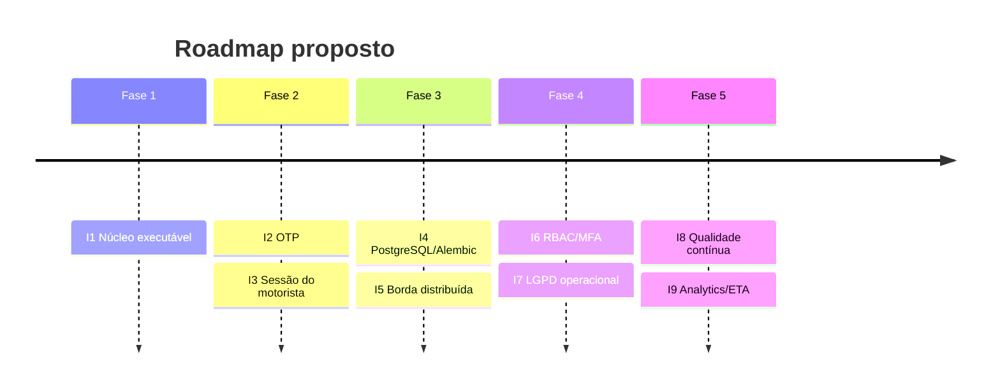

# 09 — Roadmap incremental

## 1. Princípios

- Cada incremento entrega valor observável e pode ser implantado isoladamente.
- Segurança, privacidade e operação caminham juntas; não há “fase de segurança”
  no final.
- Critérios de aceite são verificáveis por teste ou evidência documental.
- O que não tem base legal, dado ou patrocínio fica explicitamente fora.

## 2. Visão geral

| ID | Incremento | Estado | Valor | Esforço |
| --- | --- | --- | --- | --- |
| **I1** | Núcleo executável (API + PWA + dados sintéticos) | **Concluído** | Demonstração ponta a ponta | Alto |
| **I2** | OTP por SMS e consulta sem data de nascimento | Planejado | Autenticação mais forte para o paciente | Médio |
| **I3** | Endurecimento da sessão do motorista | Planejado | Menos risco de compartilhamento de PIN | Baixo/Médio |
| **I4** | PostgreSQL + Alembic + backup | Planejado | Produção confiável | Médio |
| **I5** | Rate limit distribuído + ingestão mTLS/OAuth2 | Planejado | Escala e segurança de serviço | Médio |
| **I6** | RBAC + MFA + trilha no painel | Planejado | Governança municipal | Médio/Alto |
| **I7** | Ciclo de vida LGPD (expurgo, DSR, retenção) | Planejado | Conformidade operacional | Médio |
| **I8** | Qualidade contínua (E2E, carga, observabilidade) | Planejado | Confiança para evoluir | Médio |
| **I9** | Analytics avançado e ETA | Futuro | Previsão e otimização | Alto |

## 3. Incrementos

### I1 — Núcleo executável (concluído)

**Objetivo:** provar que o comportamento reconstruído é implementável com
segurança proporcional.

**Entregue:**

- API FastAPI com 18 caminhos e contrato OpenAPI.
- PWA pública, do paciente, do motorista, do gestor e “Sobre”.
- 12 tabelas, seed sintético, simulador de telemetria.
- Pseudonimização, segundo fator, minimização, rate limit e auditoria.
- 79 testes, lint, CI, Docker e documentação.

**Critérios de aceite:** `make run`, `make test` e fumaça aprovados; nenhum CPF
em claro; posição arredondada; trilha de 12 h.

**Riscos:** escopo amplo para um TCC; mitigado por monólito modular e dados
sintéticos.

### I2 — OTP por SMS

**Objetivo:** substituir a data de nascimento por um segundo fator efêmero.

**Escopo:**

- Cadastro de telefone verificado (não apenas mascarado).
- Envio de código de 6 dígitos, validade de 5 min, no máximo 5 tentativas.
- Rate limit por CPF **e** por telefone; mensagens genéricas.
- Auditoria sem código e sem telefone em claro.
- Fallback assistido para quem não tem celular (balcão/central).

**Critérios de aceite:**

- Consulta exige OTP válido; código expira e não é reutilizável.
- Custo por envio monitorado; taxa de entrega > 95% no piloto.
- Nenhum código em log.
- Testes de replay, expiração, força bruta e troca de telefone.

**Riscos:** custo, dependência de operadora, exclusão digital. Mitigação:
provedor com fallback, atendimento presencial e opção de data de nascimento
apenas em canal assistido.

### I3 — Endurecimento da sessão do motorista

**Objetivo:** reduzir risco de PIN compartilhado e sessão roubada.

**Escopo:**

- PIN de 6 dígitos ou vínculo ao dispositivo (device binding).
- Bloqueio progressivo após tentativas (ex.: 5 → 15 min; 10 → 1 h).
- Revogação de sessão por motorista/veículo e rotação de segredo.
- Registro de dispositivo e horário de login.
- Alerta de login fora do turno.

**Critérios de aceite:**

- Bloqueio efetivo após N falhas, com desbloqueio administrativo.
- Sessão revogada deixa de funcionar imediatamente.
- Testes de força bruta e de revogação.

**Riscos:** atrito em campo; mitigado por UX simples e suporte.

### I4 — PostgreSQL, Alembic e backup

**Objetivo:** sair do SQLite de demonstração para uma base operável.

**Escopo:**

- Migrações versionadas (Alembic) com `upgrade`/`downgrade`.
- PostgreSQL 16+ gerenciado; PostGIS opcional.
- Backup diário, retenção de 30 dias e teste de restauração.
- Índices e particionamento de `posicao` por mês.
- CI com Testcontainers/Postgres efêmero.

**Critérios de aceite:**

- `alembic upgrade head` em banco vazio e em banco com dados.
- Restauração documentada e cronometrada.
- Suíte passa em SQLite **e** PostgreSQL.
- `db/schema.sql` continua gerado e consistente.

**Riscos:** diferenças de dialeto e locks; mitigado por testes em ambos.

### I5 — Borda distribuída e ingestão forte

**Objetivo:** escalar leitura e proteger a ingestão.

**Escopo:**

- Redis para rate limit e cache de posição/status.
- API Gateway/WAF com limites por rota e por chave.
- Ingestão com mTLS ou OAuth2 *client credentials* por operadora.
- Rotação de chaves e auditoria de uso por credencial.
- Deduplicação de pontos no gateway.

**Critérios de aceite:**

- Limite consistente entre réplicas.
- Credencial de uma operadora não acessa dados de outra.
- Rotação sem indisponibilidade.
- Teste de carga com 10× o volume atual.

**Riscos:** complexidade operacional; introduzir só quando houver múltiplas
réplicas/operadoras.

### I6 — RBAC, MFA e governança do painel

**Objetivo:** substituir a chave administrativa única por identidade e papéis.

**Escopo:**

- OIDC (ex.: gov.br ou provedor corporativo) + MFA.
- Papéis: regulação, operação, auditor, leitura.
- Escopo por município/operadora.
- Aprovação em duas etapas para ações sensíveis.
- Sessão com expiração curta e revogação.

**Critérios de aceite:**

- Menor privilégio comprovado por testes de autorização.
- Toda ação sensível registra ator, papel e justificativa.
- MFA obrigatório para papéis administrativos.
- Revisão de acessos trimestral.

**Riscos:** integração com identidade pública; começar por provedor OIDC
padrão e evoluir.

### I7 — Ciclo de vida LGPD

**Objetivo:** operacionalizar retenção, eliminação e direitos do titular.

**Escopo:**

- Tabela de temporalidade configurável por tipo de dado.
- Expurgo automatizado (posição, histórico, auditoria) com registro.
- Fluxo de solicitação do titular (acesso, correção, eliminação).
- Anonimização/agregação para analytics.
- DPIA e ROPA versionados; encarregado e canal publicados.
- Relatório periódico de conformidade.

**Critérios de aceite:**

- Expurgo comprovado por teste com relógio controlado.
- Solicitação do titular rastreada com prazo.
- Dados antigos não aparecem em consultas.
- Nenhum dado pessoal em dataset analítico.

**Riscos:** conflito entre retenção legal e eliminação; decidir por tipo de dado
com parecer jurídico.

### I8 — Qualidade contínua e observabilidade

**Objetivo:** detectar regressões e operar com evidência.

**Escopo:**

- E2E de navegador (Playwright) + acessibilidade (axe).
- Cobertura ≥ 85% e fuzzing de entradas.
- Métricas (latência, 4xx/5xx, fila de telemetria) e tracing.
- Alertas: erro, atraso de ingestão, veículo offline em massa.
- Painel de saúde operacional.
- Teste de carga periódico.

**Critérios de aceite:**

- E2E cobre as quatro jornadas.
- Alerta dispara em cenário simulado.
- SLO definido e medido (ex.: 99,5% de disponibilidade; p95 < 800 ms).
- Nenhum dado pessoal em métricas/traces.

**Riscos:** custo de infraestrutura; começar com OpenTelemetry + stack gerenciada.

### I9 — Analytics avançado e ETA (futuro)

**Objetivo:** prever chegada e apoiar planejamento.

**Escopo:**

- ETA por histórico de rota e condições.
- Detecção de anomalias (desvio, parada prolongada).
- Otimização de escala e ocupação.
- Simulação de cenários (mais veículos, novos destinos).

**Critérios de aceite:**

- Erro médio de ETA dentro de limite acordado.
- Modelo explicável e monitorado para *drift*.
- Nenhum dado pessoal no treinamento.
- Decisão humana mantida (não automatizar regulação).

**Riscos:** dados sintéticos/escassos; só faz sentido com histórico real e base
legal específica.

## 4. Priorização

| Critério | Peso |
| --- | --- |
| Redução de risco de privacidade/segurança | 35% |
| Valor para o cidadão/paciente | 25% |
| Viabilidade técnica no semestre | 20% |
| Custo operacional | 10% |
| Reuso para o TCC/artigo | 10% |

Aplicando os pesos, a ordem recomendada é:

1. **I3** (baixo esforço, reduz risco de acesso);
2. **I4** (base para qualquer produção);
3. **I7** (conformidade mínima);
4. **I2** (fortalece o paciente);
5. **I5** (escala);
6. **I6** (governança);
7. **I8** (qualidade contínua);
8. **I9** (pesquisa).

## 5. Métricas de sucesso por fase

| Fase | Métrica | Meta |
| --- | --- | --- |
| I2 | Consultas com OTP validado | ≥ 98% |
| I3 | Falhas de login bloqueadas | 100% após limite |
| I4 | Restauração de backup | ≤ 2 h, teste trimestral |
| I5 | p95 de leitura pública | ≤ 300 ms |
| I6 | Ações administrativas com ator identificado | 100% |
| I7 | Expurgo dentro do prazo | 100% |
| I8 | Cobertura de testes | ≥ 85% |
| I9 | Erro médio de ETA | ≤ 5 min (piloto) |

## 6. O que não será feito

- Coleta de dados reais de pacientes no protótipo.
- Reconhecimento facial, biometria ou vigilância de passageiros.
- Compartilhamento com terceiros para publicidade.
- Automação de decisão de saúde/regulação sem humano.
- Gamificação ou ranking de motoristas por localização.
- Publicação de posição exata em tempo real.

Essas exclusões são decisões éticas, não apenas técnicas. Ver
[`11-etica-e-conformidade.md`](11-etica-e-conformidade.md).
