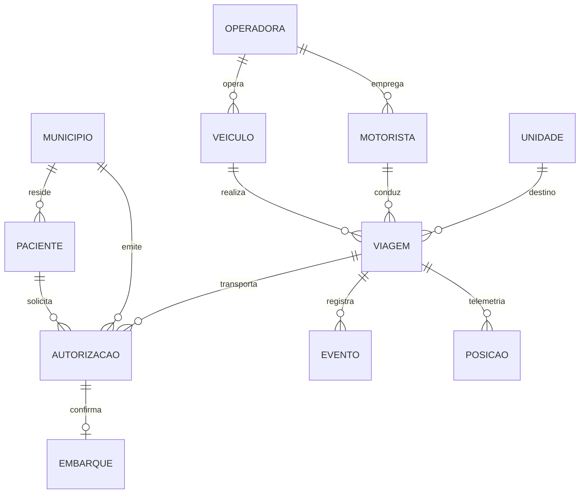
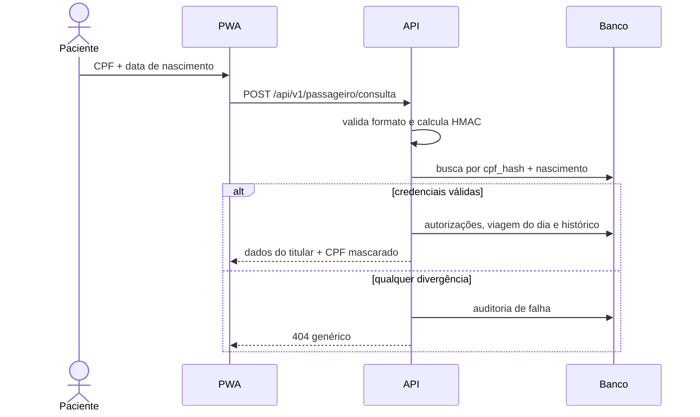
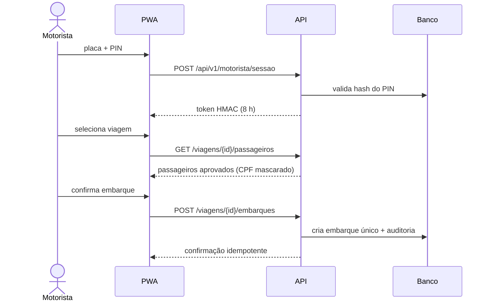
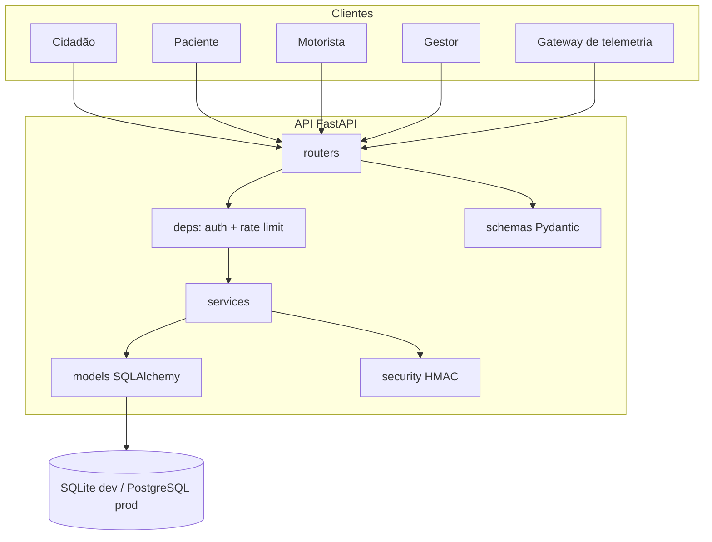
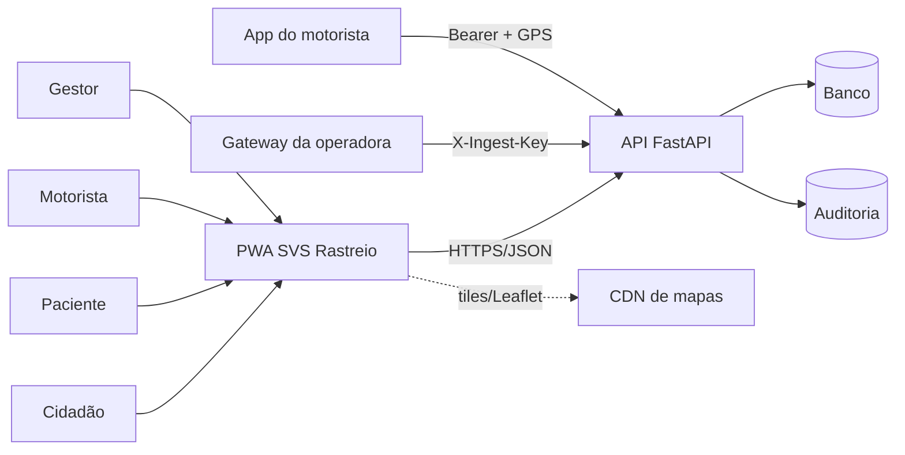
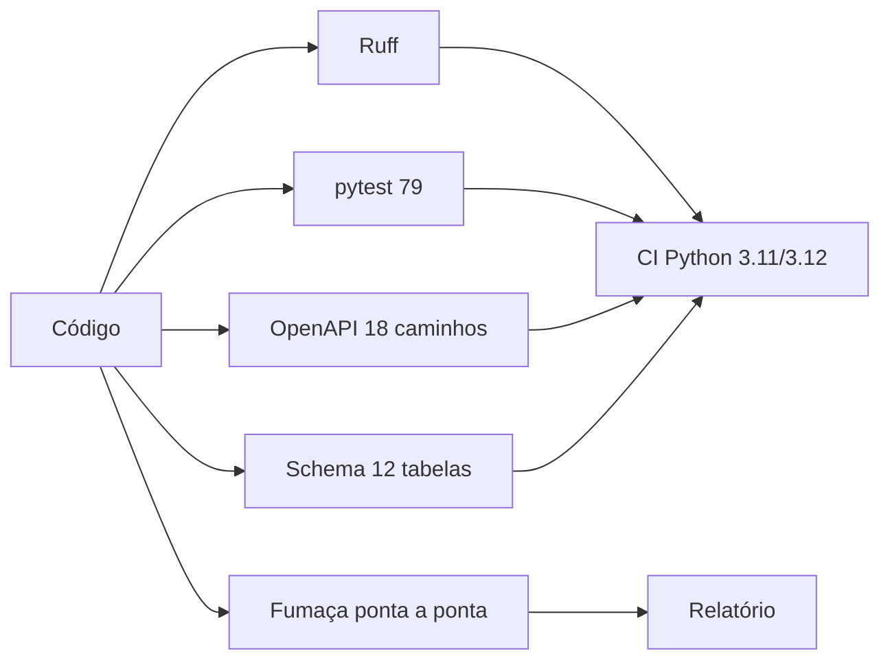

# RELATÓRIO TÉCNICO v2

## Reconstrução por engenharia reversa de caixa-preta e protótipo de rastreio logístico de passageiros do transporte público de saúde

 

**[Autor]**
**[Orientador]**
**[Instituição]**
**[Curso]**
**[Cidade] — [UF]**
**2026**

 

> **Como usar este documento.** Os campos entre colchetes são preenchidos na
> versão entregue à banca. O relatório está em estrutura ABNT (NBR 14724,
> NBR 10520 e NBR 6023) e referencia os artefatos versionados no repositório:
> dossiê, requisitos, arquitetura, modelo de dados, contrato OpenAPI, schema
> SQL, código e testes.

---

## RESUMO

Este trabalho reconstrói, de forma independente e *clean-room*, o núcleo
funcional de um sistema de rastreio logístico de passageiros do transporte
público de saúde, a partir da observação de caixa-preta de capturas de tela.
A pesquisa é aplicada, qualitativa e exploratória, conduzida como *design
science research* e organizada em nove fases que combinam engenharia reversa
de caixa-preta, especificação de requisitos e CRISP-DM. O corpus é composto por
sete capturas anonimizadas, com integridade verificada por SHA-256, das quais
cinco sustentam achados funcionais. A análise produziu um inventário de telas e
fluxos, um modelo de domínio com doze entidades e dez achados de
privacidade/segurança, classificados por gravidade e nível de confiança
(observado, inferido ou hipótese). A partir deles foram especificados 41
requisitos funcionais e 30 não funcionais, implementados em um protótipo
executável composto por API FastAPI, banco relacional, PWA sem etapa de build e
simulador de telemetria. Os controles incluem pseudonimização de CPF por
HMAC-SHA256 com *pepper*, segundo fator na consulta do paciente, posição
pública arredondada, trilha limitada a 12 horas, telemetria *append-only*,
autenticação de serviço e auditoria de acessos. A avaliação reuniu 79 testes
automatizados verdes, lint estático, 18 caminhos OpenAPI e teste de fumaça
ponta a ponta. Os resultados indicam que é possível preservar a utilidade
operacional observada e elevar o padrão de privacidade, com limites
explicitamente declarados: dados sintéticos, ausência de integração real e
riscos residuais registrados.

**Palavras-chave:** engenharia reversa; transporte público de saúde; rastreio
logístico; privacidade desde a concepção; LGPD; CRISP-DM; FastAPI.

---

## ABSTRACT

This work independently reconstructs, in a clean-room manner, the functional
core of a passenger tracking system for public health transportation, based on
black-box observation of screenshots. The research is applied, qualitative and
exploratory, conducted as design science research and organized into nine
phases combining black-box reverse engineering, requirements specification and
CRISP-DM. The corpus comprises seven anonymized screenshots whose integrity is
verified by SHA-256, five of which support functional findings. The analysis
produced a screen and flow inventory, a twelve-entity domain model and ten
privacy/security findings classified by severity and confidence level
(observed, inferred or hypothesis). From these, 41 functional and 30
non-functional requirements were specified and implemented in an executable
prototype consisting of a FastAPI backend, a relational database, a build-free
PWA and a telemetry simulator. Controls include CPF pseudonymization via
HMAC-SHA256 with a pepper, a second factor for patient queries, rounded public
position, a 12-hour track, append-only telemetry, service authentication and
access auditing. Evaluation comprised 79 passing automated tests, static
linting, 18 OpenAPI paths and an end-to-end smoke test. Results indicate that
the observed operational utility can be preserved while raising the privacy
bar, with explicitly stated limits: synthetic data, no real integration and
documented residual risks.

**Keywords:** reverse engineering; public health transportation; logistics
tracking; privacy by design; data protection; CRISP-DM; FastAPI.

---

## LISTA DE FIGURAS

| Figura | Título |
| --- | --- |
| Figura 1 | Fases do método de pesquisa |
| Figura 2 | Contexto do sistema (C4 nível 1) |
| Figura 3 | Modelo de domínio reconstruído |
| Figura 4 | Fluxo de consulta do passageiro |
| Figura 5 | Fluxo de operação do motorista |
| Figura 6 | Arquitetura de componentes do protótipo |
| Figura 7 | Pipeline de avaliação e artefatos |

## LISTA DE TABELAS

| Tabela | Título |
| --- | --- |
| Tabela 1 | Corpus de evidências anonimizadas |
| Tabela 2 | Inventário funcional observado |
| Tabela 3 | Achados de engenharia reversa e decisões |
| Tabela 4 | Requisitos funcionais por domínio |
| Tabela 5 | Entidades do modelo de dados |
| Tabela 6 | Controles de segurança e privacidade |
| Tabela 7 | Indicadores logísticos |
| Tabela 8 | Resultados da avaliação automatizada |
| Tabela 9 | Rastreabilidade entre evidências, requisitos e testes |
| Tabela 10 | Riscos residuais e encaminhamentos |

## LISTA DE ABREVIATURAS E SIGLAS

| Sigla | Significado |
| --- | --- |
| API | *Application Programming Interface* |
| ABNT | Associação Brasileira de Normas Técnicas |
| CRISP-DM | *Cross-Industry Standard Process for Data Mining* |
| CSV | *Comma-Separated Values* |
| DDL | *Data Definition Language* |
| DPIA | *Data Protection Impact Assessment* |
| GPS | *Global Positioning System* |
| HMAC | *Hash-based Message Authentication Code* |
| LGPD | Lei Geral de Proteção de Dados Pessoais |
| MVP | *Minimum Viable Product* |
| OTP | *One-Time Password* |
| OTIF | *On Time In Full* |
| PWA | *Progressive Web App* |
| ROPA | *Record of Processing Activities* |
| STRIDE | *Spoofing, Tampering, Repudiation, Information disclosure, Denial of service, Elevation of privilege* |
| SUS | Sistema Único de Saúde |
| TSS | Transporte Social em Saúde |

---

## SUMÁRIO

1 INTRODUÇÃO
1.1 Contextualização
1.2 Problema de pesquisa
1.3 Objetivos
1.4 Justificativa
1.5 Delimitações
1.6 Organização do relatório

2 REFERENCIAL TEÓRICO
2.1 Engenharia reversa de caixa-preta
2.2 Transporte público de saúde e logística
2.3 CRISP-DM e indicadores operacionais
2.4 Privacidade desde a concepção e LGPD
2.5 Qualidade de software e segurança aplicada

3 METODOLOGIA
3.1 Caracterização da pesquisa
3.2 Corpus e protocolo de evidências
3.3 Fases do método
3.4 Ética em pesquisa
3.5 Ameaças à validade

4 RESULTADOS DA ENGENHARIA REVERSA
4.1 Inventário funcional
4.2 Modelo de domínio reconstruído
4.3 Fluxos operacionais
4.4 Achados e decisões de projeto

5 ESPECIFICAÇÃO E ARQUITETURA
5.1 Requisitos
5.2 Arquitetura do protótipo
5.3 Modelo de dados
5.4 Contrato de API
5.5 Segurança e privacidade

6 IMPLEMENTAÇÃO E ANÁLISE LOGÍSTICA
6.1 Decisões de implementação
6.2 Indicadores operacionais
6.3 Simulação e reprodutibilidade
6.4 Análise CRISP-DM

7 AVALIAÇÃO
7.1 Estratégia de avaliação
7.2 Resultados dos testes
7.3 Teste de fumaça
7.4 Rastreabilidade
7.5 Limitações e riscos residuais

8 CONSIDERAÇÕES FINAIS
8.1 Contribuições
8.2 Trabalhos futuros

REFERÊNCIAS

APÊNDICE A — CATÁLOGO RESUMIDO DA API

APÊNDICE B — CREDENCIAIS SINTÉTICAS DE DEMONSTRAÇÃO

---

# 1 INTRODUÇÃO

## 1.1 Contextualização

Municípios brasileiros mantêm o Transporte Social em Saúde (TSS), serviço que
leva pacientes da rede pública a consultas, exames e tratamentos em unidades de
referência, frequentemente em outro município. A operação envolve regulação,
autorização municipal, escala de veículos e motoristas, controle de embarque e
comunicação com o paciente e seus acompanhantes (BRASIL, 1990).

Quando o cidadão não sabe onde está o veículo, aumentam as ligações para a
central, a espera no ponto de embarque e as faltas em consultas. Quando o
gestor não dispõe de dados confiáveis, não consegue medir pontualidade,
ocupação e ociosidade. Sistemas de rastreio respondem a essa necessidade, mas
tratam dados de saúde e localização — combinação de alta sensibilidade — e
precisam de controles proporcionais (BRASIL, 2018).

Este relatório descreve a reconstrução independente do núcleo funcional de um
sistema desse tipo, observado apenas por capturas de tela, e a construção de um
protótipo executável que preserva a utilidade operacional e reforça
privacidade, segurança e auditabilidade.

## 1.2 Problema de pesquisa

> Como reimplementar, de forma independente e auditável, o núcleo funcional de
> um sistema de rastreio logístico de passageiros do transporte público de
> saúde, corrigindo fragilidades de privacidade observáveis e mantendo a
> operação simples para cidadão, motorista e gestor?

O problema se desdobra em três dimensões:

1. **Engenharia reversa** — compreender funcionalidades, entidades e fluxos a
   partir de evidências externas, sem acesso a código, banco ou contratos.
2. **Logística e análise** — transformar a operação em indicadores que apoiem
   decisão, como OTIF, atraso médio, ocupação e embarques.
3. **Privacidade e segurança** — aplicar minimização, pseudonimização,
   finalidade, retenção e auditoria a dados de saúde e localização.

## 1.3 Objetivos

### 1.3.1 Objetivo geral

Construir um protótipo executável de rastreio logístico de passageiros do
transporte público de saúde, derivado de engenharia reversa de caixa-preta,
acompanhado de dossiê, relatório técnico, contrato OpenAPI e schema de dados.

### 1.3.2 Objetivos específicos

1. Registrar e anonimizar as evidências observacionais, com hashes e manifesto.
2. Inventariar telas, funcionalidades, entidades e fluxos do sistema observado.
3. Identificar fragilidades de privacidade e segurança e propor correções.
4. Especificar requisitos funcionais e não funcionais rastreáveis.
5. Implementar API, banco e PWA sem dependência de código original.
6. Instrumentar a operação com indicadores logísticos e trilha de auditoria.
7. Validar o protótipo com suíte automatizada e teste de fumaça ponta a ponta.
8. Documentar decisões, limitações, ética e conformidade.

## 1.4 Justificativa

A contribuição é tripla. **Acadêmica:** demonstra um método reprodutível de
engenharia reversa ética, com separação explícita entre observação, inferência
e hipótese. **Técnica:** entrega um artefato executável, com contrato e schema
regeneráveis, que pode ser auditado e evoluído. **Social:** mostra que um
serviço de transporte de saúde pode informar o cidadão sem expor quem ele é,
onde mora ou quando passa pelo veículo.

O trabalho também dialoga com o TCC anterior do autor, que aplicou CRISP-DM à
análise logística. Aqui, a análise de dados deixa de ser exercício sobre dados
abertos e passa a ser parte do produto: os indicadores nascem da operação
rastreada e alimentam decisões de regulação.

## 1.5 Delimitações

Estão fora do escopo: integração real com prontuários, e-SUS, regulação
municipal ou faturamento; aplicativo nativo; hardware embarcado; autenticação
federada gov.br; operação com dados reais, SLA, alta disponibilidade e suporte
24×7; e reprodução de marca, layout ou código do sistema observado.

O protótipo usa dados 100% sintéticos, com CPFs da faixa reservada
`900000xxx`, e não deve ser implantado com dados pessoais sem revisão jurídica,
DPIA e adequação de infraestrutura.

## 1.6 Organização do relatório

A seção 2 apresenta o referencial teórico. A seção 3 descreve a metodologia e
o protocolo de evidências. A seção 4 consolida os resultados da engenharia
reversa. A seção 5 detalha requisitos, arquitetura, dados, API e controles. A
seção 6 trata da implementação e da análise logística. A seção 7 avalia o
artefato. A seção 8 conclui e indica trabalhos futuros. Os apêndices resumem o
catálogo da API e as credenciais sintéticas.

---

# 2 REFERENCIAL TEÓRICO

## 2.1 Engenharia reversa de caixa-preta

Engenharia reversa é o processo de examinar um sistema para identificar seus
componentes e suas relações, com o objetivo de compreender ou reproduzir seu
comportamento (CHIKOFSKY; CROSS, 1990). Em software, a prática varia desde a
análise de binários até a observação de interfaces. EILAM (2005) descreve o
espectro entre *white-box* (código e binários), *gray-box* (documentação e
APIs) e *black-box* (apenas entradas e saídas).

Neste trabalho, só o nível caixa-preta era ético e legalmente viável. Isso
impõe uma disciplina epistemológica: uma tela que exibe “CPF” não autoriza
concluir que o CPF é armazenado em claro. O dossiê classifica cada afirmação
como **observada**, **inferida** ou **hipótese**, e registra o que não pôde ser
verificado. A reconstrução é *clean-room*: nenhum código, texto, marca ou ativo
original é reutilizado; o projeto é derivado de requisitos, não de artefatos.

## 2.2 Transporte público de saúde e logística

O TSS é uma extensão logística do Sistema Único de Saúde. A literatura de
operações costuma tratar serviços de transporte como sistemas de fila e
capacidade, em que pontualidade, ocupação e tempo de espera determinam custo e
qualidade percebida. No contexto de saúde, há uma camada adicional: a falta ao
atendimento tem consequência clínica, e a informação sobre o veículo reduz
ansiedade e ligações para a central.

Indicadores usuais incluem OTIF (*On Time In Full*), atraso médio, taxa de
ocupação, tempo de ciclo e taxa de faltas. O protótipo adota uma definição
explícita e conservadora de OTIF (seção 6.2), para evitar que o indicador se
torne uma métrica de vaidade sem relação com a operação.

## 2.3 CRISP-DM e indicadores operacionais

O CRISP-DM organiza projetos de análise em seis fases: compreensão do negócio,
compreensão dos dados, preparação, modelagem, avaliação e implantação
(CHAPMAN *et al.*, 2000). A metodologia é iterativa e orientada a valor, não a
técnica. Neste trabalho, ela é aplicada a um domínio em que os dados são
gerados pela própria operação simulada:

| Fase | Aplicação |
| --- | --- |
| Compreensão do negócio | Reduzir faltas, espera e ligações; medir OTIF e ocupação |
| Compreensão dos dados | Viagens, autorizações, embarques, eventos e posições |
| Preparação | Extração do SQLite ou CSV, limpeza e agregação por data/veículo |
| Modelagem | Indicadores descritivos e comparação de cenários |
| Avaliação | Coerência entre indicadores e operação simulada |
| Implantação | Exportação CSV e script `analytics/src/indicadores.py` |

A opção por indicadores descritivos, e não por aprendizado de máquina, é
deliberada: com dados sintéticos e um ciclo de operação curto, um modelo
preditivo não teria base estatística defensável. O roadmap prevê ETA e detecção
de anomalias apenas quando houver histórico real e base legal específica.

## 2.4 Privacidade desde a concepção e LGPD

A LGPD estabelece princípios como finalidade, adequação, necessidade,
transparência, segurança, prevenção e responsabilização (BRASIL, 2018). O
conceito de *privacy by design* propõe incorporar privacidade à arquitetura,
com padrões fortes por default, minimização e ciclo de vida (CAVOUKIAN, 2009).

No protótipo, isso se traduz em decisões verificáveis:

- CPF não é armazenado em claro; é pseudonimizado com HMAC-SHA256 e *pepper*.
- A consulta do paciente exige dois fatores e falha com mensagem genérica.
- A posição pública é arredondada e a trilha é limitada a 12 horas.
- Endpoints públicos não retornam nome, CPF, telefone ou motorista.
- Acessos sensíveis geram auditoria com IP pseudonimizado.
- Dados são sintéticos e a retenção é declarada, ainda que automatizada apenas
  no roadmap.

A LGPD também exige bases legais e governança. O relatório não substitui
parecer jurídico: propõe uma ROPA e um mapa de bases legais, sujeitos à
validação do controlador (seção 5.5 e `docs/07-seguranca-lgpd.md`).

## 2.5 Qualidade de software e segurança aplicada

A avaliação usa atributos da ISO/IEC 25010 — adequação funcional, eficiência,
compatibilidade, usabilidade, confiabilidade, segurança, manutenibilidade e
portabilidade — como grade de análise. Para segurança, o modelo STRIDE
(SHOSTACK, 2014) orienta a identificação de ameaças por ativo, e os controles
seguem recomendações do OWASP *Application Security Verification Standard* e do
OWASP Top 10 (OWASP, 2021).

A arquitetura em camadas e a separação entre transporte HTTP, regra de negócio
e persistência reduzem o acoplamento e facilitam testes. A API é tratada como
fonte da verdade: a PWA não replica regras críticas, e toda validação de
segurança acontece no servidor.

---

# 3 METODOLOGIA

## 3.1 Caracterização da pesquisa

A pesquisa é **aplicada, qualitativa e exploratória**, com desenvolvimento
tecnológico. Segundo HEVNER *et al.* (2004), *design science research* produz
artefatos e os avalia em relação ao problema. Aqui, o artefato é o protótipo, e
a avaliação combina testes automatizados, teste de fumaça e aderência a
requisitos derivados das evidências.

| Abordagem | Papel | Produto |
| --- | --- | --- |
| Engenharia reversa de caixa-preta | Descobrir comportamento externo | Dossiê, inventário, achados |
| *Design science research* | Projetar e avaliar o artefato | Protótipo, OpenAPI, schema, PWA |
| CRISP-DM | Organizar a análise operacional | Indicadores e análise em `analytics/` |

## 3.2 Corpus e protocolo de evidências

O corpus é composto por sete capturas de tela fornecidas no contexto do TCC.
Antes de qualquer versionamento, CPF, nomes, placas, telefones, e-mails e
operadoras foram removidos por tarjas opacas. As cópias anonimizadas foram
salvas em PNG, com SHA-256 e manifesto contendo descrição, origem e quantidade
de redações. Os originais foram descartados fora do repositório.

**Tabela 1 — Corpus de evidências anonimizadas**

| ID | Título | Conteúdo observado | Tarjas | SHA-256 (16 primeiros) |
| --- | --- | --- | --- | --- |
| E01 | Lista pública de veículos | Busca por placa, status, operadora, atualização | 6 placas, 3 operadoras | `9ea887398795a2b8` |
| E02 | Detalhe do veículo no mapa | Mapa, status, velocidade, distância, precisão | 2 placas | `0752b19ef23d6315` |
| E03 | Consulta por CPF com histórico | CPF localizado, viagens e veículos | 2 CPF, 5 nomes, 6 placas | `d639487fdbdccfe7` |
| E04 | Consulta por CPF sem agendamento | CPF localizado, sem autorização no dia | 2 CPF, 2 nomes, 2 placas | `788917b47bdcf1c9` |
| E05 | Visão do motorista | Seleção de placa e data; sem autorização | 2 placas | `0e93d3a89d9ca2ed` |
| E06 | Contexto do dispositivo | Tela inicial do aparelho | — | `7371aa0bfe31eb5d` |
| E07 | Contexto do dispositivo | Captura auxiliar | — | `9c3425c0c2bb612a` |

Fonte: elaborado pelo autor (2026).

O protocolo de evidências adota três níveis:

| Nível | Definição | Exemplo |
| --- | --- | --- |
| **O** — observado | Visível diretamente | Lista de veículos com status |
| **I** — inferido | Dedução razoável | A consulta envia CPF a um backend |
| **H** — hipótese | Suposição para permitir o projeto | Histórico mantido por mais de 180 dias |

E06 e E07 não sustentam achados funcionais; permanecem para rastreabilidade do
conjunto e para documentar o uso em dispositivo móvel.

## 3.3 Fases do método

**Figura 1 — Fases do método de pesquisa**

Fonte: elaborado pelo autor (2026).

As fases são detalhadas em `docs/01-metodologia.md`. Em síntese:

1. **Coleta e anonimização** — tarjas, hashes e manifesto.
2. **Inventário** — objetivo, entradas, saídas, ações, estados e dependências.
3. **Modelagem** — entidades, relações, invariantes e fluxos.
4. **Requisitos e ameaças** — RF/RNF, STRIDE, LGPD e critérios de aceite.
5. **Projeto clean-room** — API desenhada a partir de requisitos, sem copiar
   URLs, textos ou ativos.
6. **Implementação** — camadas, tipagem, seed determinístico e PWA.
7. **Validação** — testes de contrato, segurança, lint e fumaça.
8. **Análise logística** — indicadores e leitura CRISP-DM.
9. **Documentação e ética** — relatório, dossiê, ADRs e conformidade.

## 3.4 Ética em pesquisa

A engenharia reversa foi limitada à observação passiva de telas fornecidas no
contexto acadêmico. Não houve acesso a contas de terceiros, varredura de
endpoints, captura de tráfego, engenharia social ou tentativa de burlar
autenticação. Nenhum dado real foi transportado para o protótipo. A identidade
do sistema observado, de seus fornecedores e de seus operadores não é revelada.

Por se tratar de pesquisa com seres humanos, o desenho está alinhado às
Resoluções CNS nº 466/2012 e nº 510/2016, que tratam de consentimento,
confidencialidade e uso de dados. Como não há coleta de dados pessoais reais, a
submissão a Comitê de Ética deve ser avaliada pela instituição; o protocolo
está descrito em `docs/11-etica-e-conformidade.md`.

## 3.5 Ameaças à validade

| Ameaça | Efeito | Mitigação |
| --- | --- | --- |
| Poucas capturas | Cobertura parcial | Escopo declarado; hipóteses explícitas |
| Viés de interface | Confundir aparência com regra | Separação O/I/H |
| Dados sintéticos | Indicadores não generalizam | Análise como cenário demonstrativo |
| Sem acesso ao original | Sem comparação de desempenho | Avaliação por requisitos e testes |
| Ambiente local | Diferenças de produção | Checklist e riscos residuais |
| Viés do pesquisador | Confirmação de hipóteses | Testes automatizados e artefatos gerados |

---

# 4 RESULTADOS DA ENGENHARIA REVERSA

## 4.1 Inventário funcional

As capturas revelam quatro áreas: consulta pública de veículos, detalhe com
mapa, consulta individual por CPF e operação do motorista. A existência de
autorizações municipais é observada na visão do motorista.

**Tabela 2 — Inventário funcional observado**

| Área | Elementos observados | Funcionalidades reconstruídas | Nível |
| --- | --- | --- | --- |
| Consulta pública (E01) | Busca por placa, lista, status, operadora, atualização | Busca, listagem, status online/offline | O |
| Detalhe (E02) | Mapa, posição, velocidade, precisão, distância | Detalhe, mapa, trilha, resumo de viagens | O |
| Passageiro (E03) | CPF, dados, viagem, veículo, histórico | Consulta, viagem do dia, histórico | O/I |
| Passageiro (E04) | CPF localizado sem agendamento | Estado vazio explícito | O |
| Motorista (E05) | Placa e data, ausência de autorizações | Sessão, escala, passageiros, embarque | O/I/H |
| Dispositivo (E06/E07) | Contexto de uso móvel | Nenhuma funcionalidade | O |

Fonte: elaborado pelo autor (2026).

O inventário também registra o que **não** aparece: não há evidência de aviso de
finalidade, de segundo fator na consulta do paciente, de autenticação na tela do
motorista, de acessibilidade do veículo na lista ou de trilha pública. Essas
ausências são tratadas como achados e não como falhas comprovadas do sistema
original.

## 4.2 Modelo de domínio reconstruído

A partir das telas e das necessidades operacionais, propõe-se um modelo próprio
com doze entidades: município, operadora, veículo, motorista, paciente, unidade
de saúde, viagem, autorização, embarque, posição, evento de viagem e registro de
auditoria.

**Figura 3 — Modelo de domínio reconstruído**

Fonte: elaborado pelo autor (2026).

Invariantes principais:

- Uma autorização pertence a exatamente uma viagem e a um paciente.
- Uma autorização aprovada pode ter no máximo um embarque.
- Um embarque só existe para autorização aprovada da viagem.
- Uma posição pertence a um veículo e, opcionalmente, a uma viagem do mesmo
  veículo.
- Telemetria é *append-only*: não há atualização ou exclusão de pontos.
- Toda ação sensível gera registro de auditoria.

## 4.3 Fluxos operacionais

**Figura 4 — Fluxo de consulta do passageiro**

Fonte: elaborado pelo autor (2026).

**Figura 5 — Fluxo de operação do motorista**

Fonte: elaborado pelo autor (2026).

O fluxo de validação municipal (gestor lista autorizações, aprova ou nega e a
viagem planejada é promovida para autorizada) é **inferido** a partir da
existência de autorizações na visão do motorista. O protótipo o implementa de
forma explícita para tornar a operação completa.

## 4.4 Achados e decisões de projeto

**Tabela 3 — Achados de engenharia reversa e decisões**

| ID | Achado | Nível | Gravidade | Decisão no protótipo |
| --- | --- | --- | --- | --- |
| A-01 | Consulta do passageiro baseada apenas no CPF | O/I | Alta | CPF + nascimento, erro genérico, rate limit, auditoria |
| A-02 | Operação do motorista sem autenticação aparente | I | Alta | Placa + PIN, token HMAC de 8 h, vínculo ao veículo |
| A-03 | Nome, CPF e placa visíveis na consulta | O/I | Média | CPF mascarado; nome só para titular/motorista/admin |
| A-04 | Contagem de autorizações permite inferir fluxo | I | Média | Apenas agregado público, sem identidade; risco residual |
| A-05 | Posição em tempo real sem minimização | O | Alta | Arredondamento (~11 m), trilha de 12 h, 200 pontos |
| A-06 | Histórico amplo sem retenção explícita | O/H | Média | Janela de 180 dias e 30 registros |
| A-07 | Ausência de finalidade/consentimento visíveis | I | Média | Aviso na PWA, `consentimento_em`, auditoria, ROPA |
| A-08 | Falta de feedback para “sem autorização no dia” | O | Baixa | `possui_agendamento` e estado vazio orientativo |
| A-09 | Seleção manual de placa/data no motorista | O | Média | Sessão vinculada ao veículo; data padrão “hoje” |
| A-10 | Acessibilidade do veículo não evidenciada | I | Baixa | Campo `acessivel` no público e no resumo |

Fonte: elaborado pelo autor (2026).

O dossiê completo, com evidência, risco, decisão e status de cada achado, está
em `docs/02-dossie-engenharia-reversa.md`. A seção 7.5 discute os riscos
residuais que não foram eliminados.

---

# 5 ESPECIFICAÇÃO E ARQUITETURA

## 5.1 Requisitos

Foram especificados 41 requisitos funcionais e 30 não funcionais, com
prioridade, implementação e verificação. A Tabela 4 resume os funcionais por
domínio; a matriz completa está em `docs/03-requisitos.md`.

**Tabela 4 — Requisitos funcionais por domínio**

| Domínio | Faixa | Exemplos |
| --- | --- | --- |
| Rastreamento público | RF-01…RF-07 | Lista, detalhe, distância, trilha, resumo, placa, erro genérico |
| Passageiro | RF-08…RF-15 | Dois fatores, erro genérico, viagem, histórico, máscara, auditoria |
| Motorista | RF-16…RF-23 | Sessão, vínculo, escala, passageiros, embarque, eventos, GPS |
| Telemetria | RF-24…RF-28 | Chave, faixa válida, janela, vínculo, *append-only* |
| Administração | RF-29…RF-35 | KPIs, viagens, autorizações, validação, CSV, auditoria |
| Interface e operação | RF-36…RF-41 | PWA, acessibilidade, fallback, “Sobre”, healthz, seed |

Fonte: elaborado pelo autor (2026).

Os requisitos não funcionais cobrem segurança (RNF-01…RNF-08), privacidade e
LGPD (RNF-09…RNF-15), desempenho e escalabilidade (RNF-16…RNF-20), confiabilidade
e operação (RNF-21…RNF-25) e usabilidade/manutenibilidade (RNF-26…RNF-30).

Requisitos descartados neste ciclo — OTP por SMS, notificações push, integração
com regulação, app nativo, roteirização, faturamento, RBAC/MFA e migrações
Alembic — estão no roadmap com justificativa.

## 5.2 Arquitetura do protótipo

**Figura 6 — Arquitetura de componentes do protótipo**

Fonte: elaborado pelo autor (2026).

A arquitetura é um **monólito modular**: um processo FastAPI com camadas
explícitas (`routers` → `services` → `models`), contratos Pydantic e
configuração 12-factor. A PWA é servida pela própria API, sem etapa de build, e
usa Leaflet via CDN com fallback textual. A escolha reduz complexidade
operacional e mantém o artefato auditável.

**Figura 2 — Contexto do sistema (C4 nível 1)**

Fonte: elaborado pelo autor (2026).

As decisões relevantes estão registradas em ADRs: monólito FastAPI, SQLite em
desenvolvimento e PostgreSQL em produção, pseudonimização de CPF, sessão de
motorista sem estado, PWA sem build, minimização de localização e chaves de
serviço.

## 5.3 Modelo de dados

O modelo tem doze tabelas, com constraints e índices para os acessos previstos.
O DDL PostgreSQL é gerado a partir dos modelos e versionado em `db/schema.sql`;
o snapshot sintético está em `db/seed.sql`.

**Tabela 5 — Entidades do modelo de dados**

| Entidade | Papel | Dados sensíveis |
| --- | --- | --- |
| `municipio` | Origem do paciente e emissor da autorização | Não |
| `operadora` | Empresa que opera veículos e motoristas | Não |
| `veiculo` | Placa, modelo, tipo, acessibilidade, PIN | PIN pseudonimizado |
| `motorista` | Condutor vinculado à operadora | Nome, PIN pseudonimizado |
| `paciente` | Titular do transporte | Nome, CPF pseudonimizado, nascimento, telefone mascarado |
| `unidade_saude` | Destino do atendimento | Não |
| `viagem` | Trajeto, horários, status | Não |
| `autorizacao` | Vínculo paciente–viagem e validação municipal | Status, origem |
| `embarque` | Confirmação de presença | Data/hora |
| `posicao` | Telemetria *append-only* | Localização |
| `evento_viagem` | Início, chegada, fim, incidente | Não |
| `audit_log` | Ações e acessos | IP pseudonimizado, detalhe sem CPF |

Fonte: elaborado pelo autor (2026).

Índices cobrem placa, data de viagem, status de autorização, `cpf_hash` e a
combinação veículo + captura, que sustenta a consulta de última posição e a
trilha. Em produção, a telemetria pode ser particionada por mês.

## 5.4 Contrato de API

O contrato OpenAPI 3.1 é gerado a partir do código e versionado em
`openapi/openapi.yaml` e `openapi/openapi.json`. Ele contém 18 caminhos,
distribuídos em cinco grupos:

| Grupo | Exemplos | Autenticação |
| --- | --- | --- |
| Público | `/publico/veiculos`, `/{placa}`, `/trilha`, `/viagens` | Nenhuma |
| Passageiro | `/passageiro/consulta` | CPF + nascimento |
| Motorista | `/motorista/sessao`, `/viagens`, `/embarques`, `/eventos`, `/posicao` | Bearer HMAC |
| Telemetria | `/telemetria` | `X-Ingest-Key` |
| Administração | `/admin/kpis`, `/viagens`, `/autorizacoes`, `/posicoes.csv` | `X-Admin-Key` |

Fonte: elaborado pelo autor (2026).

O catálogo detalhado, com códigos de erro e exemplos, está em
`docs/06-api.md`; o Apêndice A traz um resumo. Erros usam `detail` genérico
quando a causa é sensível, e a documentação interativa é publicada em `/docs`.

## 5.5 Segurança e privacidade

**Tabela 6 — Controles de segurança e privacidade**

| Controle | Implementação | Requisito |
| --- | --- | --- |
| Pseudonimização de CPF | HMAC-SHA256 com *pepper*; máscara `***.***.***-NN` | RNF-01, RNF-11 |
| Segundo fator | CPF + data de nascimento; erro 404 genérico | RF-08, RF-09 |
| Minimização pública | Sem nome, CPF, telefone ou motorista | RNF-09 |
| Posição aproximada | 4 casas decimais (~11 m), marca de aproximação | RNF-10 |
| Trilha limitada | 12 h e 200 pontos | RF-04, RNF-10 |
| Telemetria *append-only* | Sem update/delete; janela de 24 h | RF-26, RF-28 |
| Sessão do motorista | Token HMAC assinado, 8 h, sem estado | RNF-03 |
| Chaves de serviço | `X-Ingest-Key` e `X-Admin-Key` distintas | RNF-05 |
| Rate limit | Por IP e por rota, com `Retry-After` | RNF-05 |
| Auditoria | Acesso, validação, exportação; IP pseudonimizado | RNF-12 |
| Produção segura | Recusa segredos padrão e auto-create | RNF-06 |

Fonte: elaborado pelo autor (2026).

O modelo de ameaças STRIDE e a ROPA estão em `docs/07-seguranca-lgpd.md`. A
base legal proposta é a execução de políticas públicas de saúde (LGPD, art. 7º,
III) combinada com tutela da saúde (art. 11, II, f), sempre sujeita a parecer
do controlador. Dados de localização são tratados como dados pessoais
indiretos, e a agregação/arredondamento é controle de necessidade.

---

# 6 IMPLEMENTAÇÃO E ANÁLISE LOGÍSTICA

## 6.1 Decisões de implementação

- **Backend:** Python 3.11+, FastAPI, SQLAlchemy 2.0, Pydantic v2.
- **Banco:** SQLite em desenvolvimento (WAL), PostgreSQL 16+ em produção.
- **Frontend:** PWA sem build, HTML/CSS/JS puros, Leaflet com fallback.
- **Seed:** cenário determinístico com quatro veículos, três pacientes e
  autorizações em estados distintos.
- **Simulador:** gera posições e descobre a viagem ativa pelo endpoint público.
- **Scripts:** anonimização de evidências, exportação OpenAPI, geração de schema
  e snapshot SQL.

O seed canônico é `backend/app/seed.py`; `db/seed.sql` é um snapshot gerado, com
aviso de *pepper* de desenvolvimento. Em `SVS_ENV=prod`, a aplicação se recusa a
iniciar com segredos padrão e desativa `AUTO_CREATE` e `AUTO_SEED`.

## 6.2 Indicadores operacionais

**Tabela 7 — Indicadores logísticos**

| Indicador | Definição | Fonte |
| --- | --- | --- |
| OTIF | Viagens concluídas iniciadas até `partida_prevista + 15 min` ÷ viagens concluídas | `viagem.iniciada_em` |
| Atraso médio | Média de `max(0, iniciada_em − partida_prevista)` em minutos | `viagem` |
| Ocupação | Embarques ÷ autorizações aprovadas | `embarque`, `autorizacao` |
| Viagens em andamento | Viagens com status `EM_ANDAMENTO` | `viagem.status` |
| Veículos online | Veículos com posição nos últimos 300 s | `posicao` |
| Autorizações pendentes | Autorizações `PENDENTE` na data | `autorizacao` |
| Passageiros embarcados | Embarques na data | `embarque` |

Fonte: elaborado pelo autor (2026).

A tolerância de 15 minutos para OTIF é uma decisão explícita: sem ela, qualquer
atraso de segundos reduziria o indicador e produziria leitura equivocada. O
cálculo está implementado em `GET /api/v1/admin/kpis` e replicado em
`analytics/src/indicadores.py` para análise offline.

## 6.3 Simulação e reprodutibilidade

O cenário sintético tem quatro veículos (`SVS1A23`, `SVS2B34`, `DEM0C56`,
`TST9D87`), com PINs distintos, operadoras, acessibilidade e status variados.
As viagens incluem estados planejada, autorizada, em andamento e concluída, e
as autorizações incluem aprovada, pendente, negada e cancelada. Isso permite
exercitar todos os fluxos sem dados reais.

O simulador `scripts/simular_telemetria.py` envia posições periódicas,
autenticadas com a chave de ingestão, e permite escolher placa ou rota
automática. O objetivo é demonstrar o ciclo: telemetria → status → mapa →
indicadores.

A reprodutibilidade é verificada por:

1. `make run` sobe API e PWA com seed.
2. `scripts/seed_demo.py` recria o cenário.
3. `scripts/exportar_openapi.py` e `scripts/gerar_schema_sql.py` regeneram
   contrato e DDL.
4. `make test` executa a suíte.
5. O manifesto confere hashes das evidências.

## 6.4 Análise CRISP-DM

A análise em `analytics/` parte da exportação CSV ou do banco SQLite e produz
indicadores por data, veículo e status. O material cobre as seis fases:

- **Negócio:** reduzir faltas e espera; medir pontualidade e ocupação.
- **Dados:** viagens, autorizações, embarques, eventos e posições.
- **Preparação:** normalização de datas, exclusão de registros de teste e
  agregação por dia/veículo.
- **Modelagem:** indicadores descritivos e comparação de cenários (por exemplo,
  efeito de uma tolerância maior de OTIF).
- **Avaliação:** coerência com a operação simulada e sensibilidade a valores
  extremos.
- **Implantação:** script reutilizável e relatório em notebook.

Como os dados são sintéticos, os números servem para demonstrar o método e a
mecânica de cálculo, não para inferir desempenho real de nenhum município. Essa
limitação é explicitada no relatório de análise e no dossiê.

---

# 7 AVALIAÇÃO

## 7.1 Estratégia de avaliação

A avaliação combina cinco níveis:

| Nível | Ferramenta | Escopo |
| --- | --- | --- |
| Unitário | pytest | CPF, placa, máscara, HMAC, token, rate limit, distância |
| Contrato/integração | pytest + `TestClient` | Rotas, status, esquemas, erros, banco em memória |
| Segurança/LGPD | pytest | Segundo fator, minimização, auditoria, vazamento |
| Estático | Ruff | Estilo, imports, bugs comuns |
| Fumaça | `curl`/navegador | PWA, manifest, service worker, healthz, fluxo real |

Fonte: elaborado pelo autor (2026).

**Figura 7 — Pipeline de avaliação e artefatos**

Fonte: elaborado pelo autor (2026).

## 7.2 Resultados dos testes

**Tabela 8 — Resultados da avaliação automatizada**

| Arquivo | Testes | Foco | Resultado |
| --- | --- | --- | --- |
| `tests/test_admin.py` | 18 | KPIs, viagens, autorizações, CSV, telemetria, healthz | Verde |
| `tests/test_motorista.py` | 12 | Sessão, escopo, passageiros, embarque, eventos, GPS | Verde |
| `tests/test_passageiro.py` | 10 | Dois fatores, máscara, histórico, erros, auditoria | Verde |
| `tests/test_publico.py` | 13 | Lista, busca, posição, trilha, resumo, minimização | Verde |
| `tests/test_seguranca.py` | 26 | Placa, CPF, máscara, HMAC, PIN, token, rate limit | Verde |
| **Total** | **79** | | **79/79** |

Fonte: elaborado pelo autor (2026).

Casos de segurança representativos:

| Cenário | Resultado esperado | Situação |
| --- | --- | --- |
| Token adulterado ou expirado | Rejeitado | Verificado |
| PIN errado | 401 genérico | Verificado |
| Admin/ingestão sem chave | 401 | Verificado |
| CPF inexistente × nascimento errado | Mesma resposta 404 | Verificado |
| Placa inválida × inexistente | Mesma resposta 404 | Verificado |
| Rate limit | 429 após limite; outra chave liberada | Verificado |
| CPF em claro | Ausente nas respostas | Verificado |
| Coordenada precisa | No máximo 4 casas | Verificado |
| Telemetria de outra viagem | 422 | Verificado |
| Viagem de outro veículo | 404 | Verificado |

Fonte: elaborado pelo autor (2026).

## 7.3 Teste de fumaça

O teste de fumaça foi executado contra o servidor real, com seed automático. As
verificações incluíram: raiz e páginas da PWA, manifesto, service worker, ícone,
`/healthz`, consulta do paciente, sessão do motorista, KPIs, autorizações e
simulador de telemetria. Todas responderam conforme o esperado, com status 200
e conteúdo compatível.

O simulador foi exercitado por alguns segundos e produziu posições gravadas,
com o veículo passando a `ONLINE`. Esse resultado fecha o ciclo funcional:
ingestão autenticada → persistência → status → leitura pública.

## 7.4 Rastreabilidade

**Tabela 9 — Rastreabilidade entre evidências, requisitos e testes**

| Origem | Requisitos | Rotas | Testes |
| --- | --- | --- | --- |
| E01/E02 — lista e mapa | RF-01…RF-07 | `/publico/*` | `test_publico.py` |
| E03/E04 — consulta por CPF | RF-08…RF-15 | `/passageiro/consulta` | `test_passageiro.py` |
| E05 — visão do motorista | RF-16…RF-23 | `/motorista/*` | `test_motorista.py` |
| Operação de campo | RF-24…RF-28 | `/telemetria` | `test_publico.py` |
| Gestão municipal | RF-29…RF-35 | `/admin/*` | `test_admin.py` |
| Produto/PWA | RF-36…RF-41 | `/`, `/sobre`, `/docs` | fumaça + CI |
| Segurança/LGPD | RNF-01…RNF-15 | transversal | `test_seguranca.py` |
| Operação | RNF-16…RNF-30 | transversal | CI + revisão |

Fonte: elaborado pelo autor (2026).

A cobertura funcional observada é de 100% das telas E01–E05. Isso não significa
paridade com o sistema original: significa que as funcionalidades identificadas
nas capturas têm correspondência no protótipo, com as diferenças deliberadas
documentadas.

## 7.5 Limitações e riscos residuais

**Tabela 10 — Riscos residuais e encaminhamentos**

| Risco | Descrição | Encaminhamento |
| --- | --- | --- |
| R-01 | PIN curto e compartilhável | Roadmap I3: PIN de 6 dígitos, bloqueio progressivo |
| R-02 | Chave administrativa estática | Roadmap I6: OIDC + MFA + RBAC |
| R-03 | Rate limit em memória | Roadmap I5: Redis distribuído |
| R-04 | Retenção não automatizada | Roadmap I7: expurgo e ciclo de vida |
| R-05 | Contagem de autorizações agregada | Risco aceito e documentado; monitorar uso |
| R-06 | Dados sintéticos não generalizam | Análise como demonstração; piloto com base legal |
| R-07 | Sem E2E de navegador | Roadmap I8: Playwright + axe |
| R-08 | Sem migrações versionadas | Roadmap I4: Alembic |
| R-09 | Sem observabilidade de produção | Roadmap I8: métricas e tracing |
| R-10 | Texto jurídico provisório | Validação pelo controlador e encarregado |
| R-11 | Ausência de DPIA formal | Roadmap I7, antes de dados reais |

Fonte: elaborado pelo autor (2026).

O protótipo **não** deve ser usado com dados reais sem: parecer jurídico,
DPIA, definição de controlador e operador, contrato de tratamento, infraestrutura
com backup e monitoramento, testes de carga, gestão de identidade e processo de
resposta a incidentes.

---

# 8 CONSIDERAÇÕES FINAIS

## 8.1 Contribuições

O trabalho demonstra um caminho reprodutível para reconstruir, com ética, um
sistema observado apenas por sua interface. As principais contribuições são:

1. **Método** — protocolo de evidências com níveis O/I/H, anonimização
   verificável e dossiê que separa fato de hipótese.
2. **Artefato** — protótipo executável com API, banco, PWA, simulador e
   documentação, reproduzível por comandos.
3. **Privacidade aplicada** — pseudonimização, segundo fator, minimização de
   localização, auditoria e recusa de segredos padrão em produção.
4. **Análise logística** — indicadores com definição explícita e leitura
   CRISP-DM, integráveis à operação.
5. **Governança** — requisitos rastreáveis, ADRs, riscos residuais, política de
   segurança e análise ética.

A resposta ao problema de pesquisa é afirmativa dentro do escopo: é possível
preservar a utilidade operacional observada e elevar o padrão de privacidade,
desde que as limitações sejam declaradas e os riscos residuais tenham
encaminhamento.

## 8.2 Trabalhos futuros

1. **I2** — OTP por SMS e consulta assistida para quem não tem celular.
2. **I3** — endurecimento da sessão do motorista (PIN de 6 dígitos, *device
   binding*, revogação).
3. **I4** — PostgreSQL, Alembic, backup e restauração testada.
4. **I5** — rate limit distribuído, mTLS/OAuth2 na ingestão e deduplicação.
5. **I6** — RBAC, MFA e trilha de aprovação no painel.
6. **I7** — ciclo de vida LGPD: retenção, expurgo, DSR e DPIA.
7. **I8** — E2E, acessibilidade, carga e observabilidade.
8. **I9** — ETA e detecção de anomalias com dados reais e base legal.

Também são promissores: estudo de usabilidade com motoristas e pacientes,
avaliação de impacto orçamentário da redução de faltas e comparação com
políticas públicas de transporte sanitário.

---

# REFERÊNCIAS

ASSOCIAÇÃO BRASILEIRA DE NORMAS TÉCNICAS. **NBR 6023**: informação e
documentação — referências — elaboração. Rio de Janeiro: ABNT, 2018.

ASSOCIAÇÃO BRASILEIRA DE NORMAS TÉCNICAS. **NBR 10520**: informação e
documentação — citações em documentos — apresentação. Rio de Janeiro: ABNT,
2023.

ASSOCIAÇÃO BRASILEIRA DE NORMAS TÉCNICAS. **NBR 14724**: informação e
documentação — trabalhos acadêmicos — apresentação. Rio de Janeiro: ABNT, 2011.

BRASIL. **Lei nº 8.080, de 19 de setembro de 1990**. Dispõe sobre as condições
para a promoção, proteção e recuperação da saúde, a organização e o
funcionamento dos serviços correspondentes. Brasília, DF: Presidência da
República, 1990.

BRASIL. **Lei nº 13.709, de 14 de agosto de 2018**. Lei Geral de Proteção de
Dados Pessoais (LGPD). Brasília, DF: Presidência da República, 2018.

CAVOUKIAN, Ann. **Privacy by design**: the 7 foundational principles.
Toronto: Information and Privacy Commissioner of Ontario, 2009.

CHAPMAN, Pete; CLINTON, Julian; KERBER, Randy; KHABAZA, Thomas; REINARTZ,
Thomas; SHEARER, Colin; WIRTH, Rüdiger. **CRISP-DM 1.0**: step-by-step data
mining guide. Chicago: SPSS, 2000.

CHIKOFSKY, Elliot J.; CROSS, James H. Reverse engineering and design recovery:
a taxonomy. **IEEE Software**, v. 7, n. 1, p. 13–17, 1990.

CONSELHO NACIONAL DE SAÚDE. **Resolução nº 466, de 12 de dezembro de 2012**.
Diretrizes e normas regulamentadoras de pesquisas envolvendo seres humanos.
Brasília, DF: CNS, 2012.

CONSELHO NACIONAL DE SAÚDE. **Resolução nº 510, de 7 de abril de 2016**.
Dispõe sobre as normas aplicáveis a pesquisas em Ciências Humanas e Sociais.
Brasília, DF: CNS, 2016.

EILAM, Eldad. **Reversing**: secrets of reverse engineering. Indianapolis:
Wiley, 2005.

HEVNER, Alan R.; MARCH, Salvatore T.; PARK, Jinsoo; RAM, Sudha. Design science
in information systems research. **MIS Quarterly**, v. 28, n. 1, p. 75–105,
2004.

INTERNATIONAL ORGANIZATION FOR STANDARDIZATION. **ISO/IEC 25010:2011**: systems
and software Quality Requirements and Evaluation (SQuaRE) — system and software
quality models. Genebra: ISO, 2011.

INTERNATIONAL ORGANIZATION FOR STANDARDIZATION. **ISO/IEC 27701:2019**:
security techniques — extension to ISO/IEC 27001 and ISO/IEC 27002 for privacy
information management. Genebra: ISO, 2019.

OWASP FOUNDATION. **OWASP Top 10:2021**: the ten most critical web application
security risks. 2021. Disponível em: <https://owasp.org/Top10/>. Acesso em: 29
out. 2026.

OWASP FOUNDATION. **Application Security Verification Standard 4.0.3**. 2021.
Disponível em: <https://owasp.org/www-project-application-security-verification-standard/>.
Acesso em: 29 out. 2026.

SHOSTACK, Adam. **Threat modeling**: designing for security. Indianapolis:
Wiley, 2014.

SOMMERVILLE, Ian. **Engenharia de software**. 10. ed. São Paulo: Pearson, 2019.

---

# APÊNDICE A — CATÁLOGO RESUMIDO DA API

| Método | Caminho | Finalidade | Auth |
| --- | --- | --- | --- |
| GET | `/healthz` | Saúde da aplicação | — |
| GET | `/api/v1/publico/veiculos` | Lista veículos e status | — |
| GET | `/api/v1/publico/veiculos/{placa}` | Detalhe e posição aproximada | — |
| GET | `/api/v1/publico/veiculos/{placa}/trilha` | Trilha das últimas 12 h | — |
| GET | `/api/v1/publico/veiculos/{placa}/viagens` | Resumo de viagens do dia | — |
| POST | `/api/v1/passageiro/consulta` | Viagem e histórico do titular | CPF + nascimento |
| POST | `/api/v1/motorista/sessao` | Login por placa + PIN | Placa + PIN |
| GET | `/api/v1/motorista/viagens` | Escala do veículo | Bearer |
| GET | `/api/v1/motorista/viagens/{id}/passageiros` | Passageiros aprovados | Bearer |
| POST | `/api/v1/motorista/viagens/{id}/embarques` | Registrar embarque | Bearer |
| POST | `/api/v1/motorista/viagens/{id}/eventos` | Evento operacional | Bearer |
| POST | `/api/v1/motorista/posicao` | GPS do app | Bearer |
| POST | `/api/v1/telemetria` | Ingestão de posição | `X-Ingest-Key` |
| GET | `/api/v1/admin/kpis` | Indicadores do dia | `X-Admin-Key` |
| GET | `/api/v1/admin/viagens` | Viagens da data | `X-Admin-Key` |
| GET | `/api/v1/admin/autorizacoes` | Autorizações por data/status | `X-Admin-Key` |
| POST | `/api/v1/admin/autorizacoes/{id}/validar` | Aprovar ou negar | `X-Admin-Key` |
| GET | `/api/v1/admin/posicoes.csv` | Exportar telemetria | `X-Admin-Key` |

Fonte: elaborado pelo autor (2026).

# APÊNDICE B — CREDENCIAIS SINTÉTICAS DE DEMONSTRAÇÃO

| Perfil | Credencial |
| --- | --- |
| Passageiro Alfa | CPF `90000010138`, nascimento `1990-05-12` |
| Passageiro Beta | CPF `90000010219`, nascimento `1985-11-03` |
| Passageiro Gama | CPF `90000010308`, nascimento `1978-02-20` |
| Motorista SVS1A23 | PIN `1234` |
| Motorista SVS2B34 | PIN `4321` |
| Motorista DEM0C56 | PIN `5678` |
| Motorista TST9D87 | PIN `8765` |
| Painel administrativo | `dev-admin-key` |
| Ingestão de telemetria | `dev-ingest-key` |

Fonte: elaborado pelo autor (2026).

> Os CPFs pertencem à faixa reservada para testes `900000xxx`, têm dígitos
> verificadores válidos e não correspondem a pessoas reais. As credenciais
> existem apenas em modo `dev`; em `prod`, a aplicação recusa os valores padrão.
